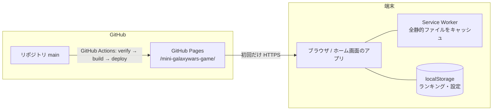
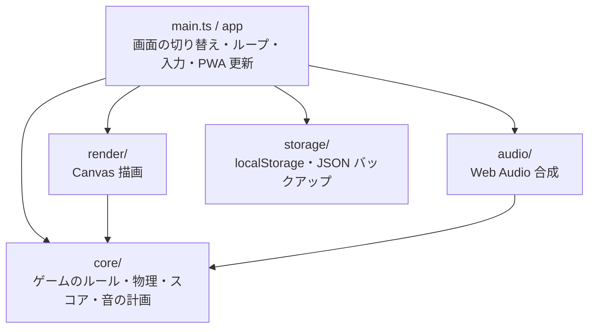
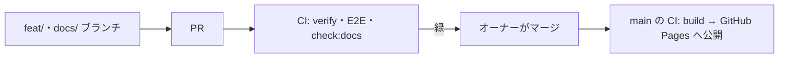

# システム構成

## 1. 全体像

サーバーを持たない静的な Web アプリ（PWA）。GitHub Pages から配信し、一度読み込んだあとは端末だけで動く。

- 外部のサーバー・CDN・Web フォントには繋がない（仕様書 §1.2、§25）。文字は Canvas に自前のビットマップフォントで描く。
- 公開 URL：`https://tsuku3dayo.github.io/mini-galaxywars-game/`（MGW-ADR-0003）。

## 2. 層と依存の向き

仕様書 §16 のフォルダを層として使う。依存は矢印の向きだけに許す（MGW-ADR-0001）。

| 層 | 役割 | 触ってよいもの | 触ってはいけないもの |
| :--- | :--- | :--- | :--- |
| core | 状態の更新（1/120 秒ステップ）、衝突判定、スコア、どの音を鳴らすかの計画 | 純粋な TypeScript だけ | DOM、`Date`・`performance`、`Math.random`、Web API |
| render | core の状態を Canvas に描く。擬似カラー・フラッシュ | Canvas 2D、core の型 | 状態の書き換え |
| audio | core の音の計画を Web Audio で鳴らす | Web Audio、core の型 | 状態の書き換え |
| storage | ランキング・設定の読み書き、JSON の書き出し・読み込み | localStorage、Blob・File | core・render・audio |
| main（app） | ハッシュルーティング、ゲームループ、入力の変換、PWA の更新ボタン、組み立て | すべて | — |

## 3. 実行時の流れ

### 3.1 ゲームループ（MGW-ADR-0002）

1. `requestAnimationFrame` で経過時間を測る（時刻を読むのは main だけ）。
2. 経過時間を 1/120 秒ずつ積み、そのたびに `core.step(state, input)` を呼ぶ。1 回の描画で進めるのは最大 12 ステップ（100 ms）。
3. ステップの結果の音の計画を audio に渡し、最後の状態を render が描く。
4. 入力は、ステップの直前に、その時点の「横位置・発射・噴射」に変換して core に渡す。入力の列を記録すれば、同じ展開を再現できる。

### 3.2 画面（仕様書 §18）

`#/title`、`#/play`、`#/ranking` のハッシュルーティング。画面の部品と、ほかに要る画面（名前の入力・設定など）は 03 で決める。

### 3.3 起動と更新（MGW-ADR-0004）

1. `index.html` が先に `boot.js`（モジュールでない普通のスクリプト）を読む。
2. `boot.js` は 8 秒のタイマーを始める。アプリが起動を知らせたら止める。8 秒たっても知らせがなければ、復旧の画面を出す。
3. Service Worker は新しい版を見つけても勝手に切り替えない。アプリが「更新」ボタンを出し、押したときだけ切り替えて再読み込みする。

### 3.4 保存（MGW-ADR-0005）

| キー | 中身 |
| :--- | :--- |
| `galaxy-wars-scores` | ランキングの上位 10 件（仕様書 §21） |
| `mini-galaxywars-settings` | 設定（表示方式など。中身は 02〜04 で決める） |

Service Worker のキャッシュ名には `mini-galaxywars` を付ける。

## 4. 開発・公開の流れ

- `npm run verify`：lint・型チェック・単体テスト・build・dist の検査・check:docs（MGW-TS-0001）。
- E2E：Playwright で PC（Chromium）と iPhone の画面サイズ（WebKit）を動かす。
- main へのマージで公開される。

## 5. 前提との対応（MGW-PB-0001 §3 → どこで決めたか）

| 前提 | 決めた場所 |
| :--- | :--- |
| サーバーなし | この文書 §1、MGW-ADR-0003 |
| オフライン・外部 CDN なし | この文書 §1、MGW-ADR-0004 |
| 対象の端末（iPhone・PC） | この文書 §4（E2E）、MGW-TS-0001 |
| 公開先（GitHub Pages、公開リポジトリ） | MGW-ADR-0003 |
| 固定タイムステップ・決定性 | MGW-ADR-0002 |
| 技術（TypeScript・Vite など） | MGW-TS-0001、MGW-ADR-0006 |
| アプリ識別子・保存のキー | MGW-ADR-0005 |
| PWA の更新・起動の復旧 | MGW-ADR-0004 |
| 作品名の扱い（リスク） | MGW-ADR-0007 |
| 成果物の ID | MGW-PB-0001 §3 で決定済み |

## 6. ここで決めず、後の工程で決めること

| 内容 | 工程 |
| :--- | :--- |
| 画面の部品・大きさの合わせ方（拡大の仕方・安全領域） | 03 |
| E2E 用の入口（`?debug=1`、body の data 属性など） | 04 |
| モジュールごとの関数・データ型の詳細 | 04 |

## 改訂履歴

| 版 | 日付 | 内容 |
| :--- | :--- | :--- |
| 1.0 | 2026-10-26 | 初版 |
| 1.1 | 2026-10-26 | §3.4 の設定の中身から「基板の版」を消す（仕様書 v1.2 でタイトー版に固定）。sources の版の表記を直す |
