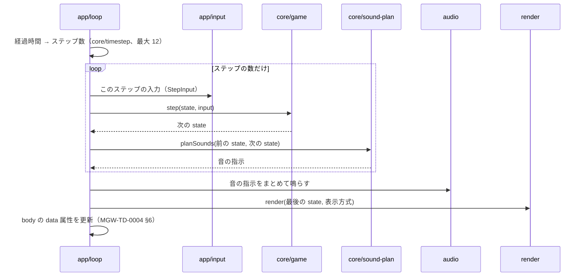

# MGW-TD-0001 全体の設計

## 1. ファイル構成

仕様書 §16 のフォルダに、組み立てを受け持つ `src/app/` と、起動の復旧の `public/boot.js` を足す（MGW-ADR-0001 の main（app））。

```
index.html                 # 画面の骨組み（上のバー・ゲーム画面・操作空間・重ねる画面）
public/
├── boot.js                # 起動の復旧（MGW-TD-0007）
└── icons/                 # ホーム画面のアイコン
src/
├── core/                  # ロジック層（MGW-TD-0002）。DOM・時刻・乱数に触れない
│   ├── config.ts          # 定数
│   ├── types.ts           # GameState などの型
│   ├── game.ts            # newGame・step・togglePause
│   ├── physics.ts         # 動き（UFO・隕石・光線・ミサイル）と当たり判定・光線弾き
│   ├── scoring.ts         # 部位の得点・600 点ボーナス・増機
│   ├── timestep.ts        # 1/120 秒の積み上げ（経過時間 → ステップ数）
│   └── sound-plan.ts      # 前後の状態から鳴らす音を決める
├── render/                # 描画層（MGW-TD-0003）
│   ├── canvas.ts          # 描く順番・倍率
│   ├── color-palette.ts   # 擬似カラー・被弾フラッシュ
│   └── sprites.ts         # ドット絵とビットマップフォント
├── audio/
│   └── synthesizer.ts     # Web Audio の合成（MGW-TD-0005）
├── storage/
│   ├── ranking-store.ts   # ランキング・JSON の書き出し／読み込み（MGW-TD-0006）
│   └── settings-store.ts  # 設定（表示方式）
├── app/                   # 組み立て層（MGW-TD-0004）
│   ├── router.ts          # ハッシュルーティング
│   ├── layout.ts          # 大きさの合わせ方・スクロールを 0 に戻す
│   ├── loop.ts            # requestAnimationFrame とステップの実行
│   ├── input.ts           # キー・ポインター → StepInput
│   ├── screens/           # title・play・ranking・entry・settings・update-banner
│   ├── pwa.ts             # Service Worker の登録と「更新」
│   └── debug.ts           # ?debug=1 のテスト用の入口とデバッグ表示
├── style.css
└── main.ts                # 起動（boot.js に起動を知らせる）
tests/unit/                # Vitest
e2e/                       # Playwright
scripts/                   # check-docs.mjs・check-dist.mjs
```

## 2. データの流れ（1 回の描画）



## 3. 画面の部品と状態を作るモジュール（GUI との対応）

| GUI | 部品・状態・メッセージ | 作るモジュール |
| :--- | :--- | :--- |
| MGW-GUI-0001 | 3 段の組み立て、倍率、安全領域、スクロールを 0 に戻す、色と文字、アプリの名前 | `index.html`・`style.css`・`app/layout.ts`・`render/sprites.ts`（フォント）・`vite.config.ts`（マニフェスト） |
| MGW-GUI-0002 | タイトル、HIGH、START・RANKING・SETTINGS、操作の案内、原作の表記 | `app/screens/title.ts` |
| MGW-GUI-0003 | HUD（SCORE・HIGH・残機）、ゲームの絵、バックファイア、爆発、操作空間 | `render/canvas.ts`・`render/sprites.ts`・`index.html`（操作空間） |
| MGW-GUI-0003 | タッチの決まり（なぞる・離して発射・触れ続けて噴射） | `app/input.ts` |
| MGW-GUI-0003 | Pause・PAUSE・RESUME、READY・GOOD!!・STAGE CLEAR・GAME OVER、TITLE | `app/screens/play.ts`（状態は `core/game.ts`） |
| MGW-GUI-0003 | デバッグ表示 | `app/debug.ts` |
| MGW-GUI-0004 | NEW RECORD!、順位、名前の入力、登録・スキップ | `app/screens/entry.ts`・`storage/ranking-store.ts` |
| MGW-GUI-0005 | RANKING の一覧、まだ記録がありません、書き出し・読み込み、確認、このファイルは読み込めません、TITLE | `app/screens/ranking.ts`・`storage/ranking-store.ts` |
| MGW-GUI-0006 | SETTINGS、表示方式、閉じる | `app/screens/settings.ts`・`storage/settings-store.ts` |
| MGW-GUI-0006 | 擬似カラーの色、被弾フラッシュ | `render/color-palette.ts` |
| MGW-GUI-0007 | 新しい版があります・更新 | `app/screens/update-banner.ts`・`app/pwa.ts` |
| MGW-GUI-0007 | 起動できませんでした・再読み込み・キャッシュを消して再読み込み・ランキングは消えません | `public/boot.js` |

## 4. 層の決まりの守り方（MGW-ADR-0001）

ESLint の設定で、ファイルの場所ごとに次をエラーにする。

| 場所 | 禁止 |
| :--- | :--- |
| `src/core/**` | `window`・`document`・`navigator`・`localStorage`・`performance`・`requestAnimationFrame` の参照、`Date`、`Math.random`、`src/core` の外の import |
| `src/render/**`・`src/audio/**` | `src/app`・`src/storage` の import |
| `src/storage/**` | `src/core`・`src/render`・`src/audio`・`src/app` の import |

## 5. 詳細の文書

| ID | 中身 |
| :--- | :--- |
| MGW-TD-0002 | core：定数・状態・1 ステップの手順・当たり判定・得点・音の計画 |
| MGW-TD-0003 | render：描く順番・ドット絵・フォント・擬似カラー |
| MGW-TD-0004 | app：ルーティング・画面・入力・ループ・テスト用の入口 |
| MGW-TD-0005 | audio：音の合成 |
| MGW-TD-0006 | storage：ランキング・設定・JSON |
| MGW-TD-0007 | PWA・起動の復旧・ビルド・CI・Lint |
