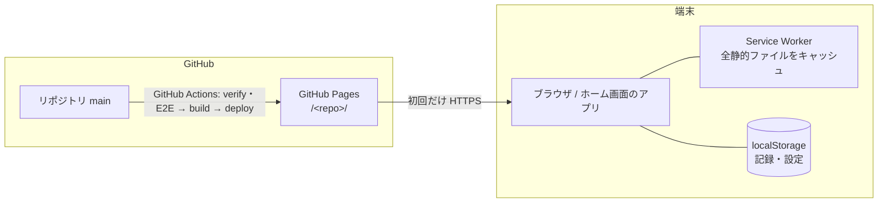
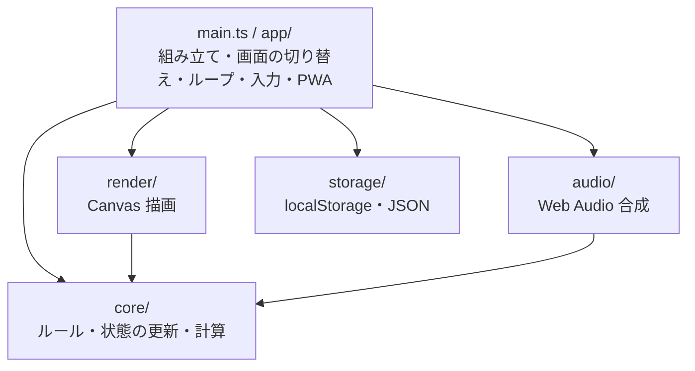

# 流用できるシステム構成と技術スタック

銀河戦争ミニ（1.0.0）で使った構成を、ほかのアプリで使い回せるようにまとめたもの。
このプロジェクトの決定は MGW-SA-0001・MGW-TS-0001・MGW-ADR-0001〜0007 にある。ここでは「なぜそうしたか」と「新しいアプリで何を置き換えるか」を中心に書く。

- 進め方（文書・承認・WS・TASK の流れ）は [SDD-PROCESS_v2.md](SDD-PROCESS_v2.md) を使う。この文書は「作り」のほうだけを扱う。
- 版は 2026-10-26 に確かめたもの（§7）。流用するときは、その日の最新を確かめ直す。

## 目次

1. [向いているアプリ](#1-向いているアプリ)
2. [全体像](#2-全体像)
3. [層と依存の向き](#3-層と依存の向き)
4. [フォルダ構成](#4-フォルダ構成)
5. [実行時の仕組み](#5-実行時の仕組み)
6. [テストと検査](#6-テストと検査)
7. [技術スタック](#7-技術スタック)
8. [設定ファイルのひな形](#8-設定ファイルのひな形)
9. [CI と公開](#9-ci-と公開)
10. [流用のときに置き換えるもの（チェックリスト）](#10-流用のときに置き換えるものチェックリスト)
11. [落とし穴](#11-落とし穴)
12. [使わないもの](#12-使わないもの)

---

## 1. 向いているアプリ

| 向いている | 向いていない |
| :--- | :--- |
| サーバーなしで端末だけで動くもの（ゲーム・道具・電卓・記録帳など） | ログイン・複数の端末での同期・共有が要るもの |
| iPhone のホーム画面に置いて、オフラインで使いたいもの | 大きなファイル（動画・大量の画像）を扱うもの |
| Canvas に描く画面、または DOM の少ない画面 | 画面と入力欄が多い業務アプリ（UI フレームワークがあったほうが楽） |
| 結果を再現したい（テストで同じ展開を確かめたい）もの | |

前提：

- 静的な PWA。GitHub Pages から配る。一度読み込んだら通信しない。
- 外部の CDN・Web フォント・サーバー・BaaS は使わない。
- 保存は localStorage。消えたときのために JSON の書き出し・読み込みを持つ。
- 対象の端末は iPhone（Safari・ホーム画面のアプリ）と PC（Chrome・Edge）。

## 2. 全体像



- 公開 URL：`https://<user>.github.io/<repo>/`。Vite の `base` は `/<repo>/`。
- 文字を Canvas に描くなら、自前のビットマップフォントにする（Web フォントを読まない）。DOM の文字はシステムのフォントを使う。

## 3. 層と依存の向き

依存は矢印の向きだけに許し、ESLint で破るとエラーにする（MGW-ADR-0001）。



| 層 | 役割 | 使ってよい | 使ってはいけない |
| :--- | :--- | :--- | :--- |
| core | 状態の更新（固定ステップ）、判定、点数、「どの音を鳴らすか」の計画 | 純粋な TypeScript | DOM・`window`、`Date`・`performance`、`Math.random`、ほかの層の import |
| render | core の状態を Canvas に描く | Canvas 2D、core の型と関数 | 状態の書き換え、app・storage の import |
| audio | core の音の計画を鳴らす | Web Audio、core の型と関数 | 状態の書き換え、app・storage の import |
| storage | 保存・読み込み、JSON の書き出し・読み込み | `Storage`（外から渡す） | ほかの層の import |
| app（main.ts） | 時刻・入力・乱数の種を読み、各層を組み立てる | すべて | — |

この形にした理由：

- core が DOM も時刻も読まないので、Vitest だけで（ブラウザなしで）ほぼ全部を確かめられる。
- 時刻と乱数を外から渡すので、「種＋入力の列」で同じ展開を何度でも再現できる。
- render・audio を差し替えても core は変わらない（表示方式の切り替え、音のオン・オフが楽）。

## 4. フォルダ構成

```text
.
├─ index.html              # 骨組み。boot.js をアプリ本体より先に読む
├─ public/
│  ├─ boot.js              # 起動の復旧（ES5 の普通のスクリプト）
│  └─ icons/               # icon-180（apple-touch-icon）・192・512
├─ src/
│  ├─ main.ts              # 組み立て（ここだけが全部を知る）
│  ├─ style.css
│  ├─ app/                 # loop・router・input・layout・pwa・debug・screens/
│  ├─ core/                # config・types・game（step）・timestep・random・scoring・sound-plan
│  ├─ render/              # canvas・sprites・hud・色
│  ├─ audio/               # synthesizer
│  └─ storage/             # ranking-store・settings-store
├─ tests/unit/             # Vitest（core・storage・render の純粋な部分・層の決まり）
├─ e2e/                    # Playwright（dist を vite preview で動かす）
├─ scripts/
│  ├─ check-dist.mjs       # build したものの検査
│  └─ check-docs.mjs       # 成果物の整合性（SDD を使うとき）
├─ prototype/              # 画面の試作（公開はするが SW のキャッシュには入れない）
└─ .github/workflows/      # ci.yml（PR）・pages.yml（main → 公開）
```

## 5. 実行時の仕組み

### 5.1 固定タイムステップ（MGW-ADR-0002、`src/core/timestep.ts`・`src/app/loop.ts`）

1. app が `requestAnimationFrame` の時刻から経過時間を求める（時刻を読むのは app だけ）。
2. 経過時間を `1000 / STEPS_PER_SECOND` ms ずつ積み、そのたびに `core.step(state, input)` を 1 回呼ぶ。
3. 1 回の描画で進めるのは最大 N ステップ（このアプリは 120 Hz で 12 ステップ = 100 ms）。超えた分は捨てる（遅れを取り戻そうとしない）。
4. 描画は最後の状態をそのまま描く（補間しない）。
5. タブが隠れたら（`visibilitychange`）一時停止にする。

```ts
// core/timestep.ts — DOM に触れない純粋な関数なので単体テストできる
const EPSILON_MS = 1e-6; // 60 Hz・120 Hz の足し算の誤差で 1 ステップ足りなくならないように
export function planSteps(acc: number, elapsedMs: number): { steps: number; acc: number } {
  let total = acc + Math.max(0, elapsedMs);
  let steps = 0;
  while (total + EPSILON_MS >= STEP_MS && steps < MAX_STEPS_PER_FRAME) { total -= STEP_MS; steps += 1; }
  if (steps === MAX_STEPS_PER_FRAME && total + EPSILON_MS >= STEP_MS) total = 0;
  return { steps, acc: Math.max(0, total) };
}
```

### 5.2 乱数は種から（`src/core/random.ts`）

- core は `Math.random` を使わない。app がゲームの始めに種を決め（`crypto.getRandomValues`、だめなら時刻）、core が mulberry32 で数の列を作る。
- `?debug=1&seed=<整数>` で種を固定できるようにし、E2E と手動の再現に使う。
- 入力の記録は「種」と「ステップの番号と入力」の列。

### 5.3 入力（`src/app/input.ts`）

- キー（KeyboardEvent）とポインター（Pointer Events）を、ステップごとに 1 つの `StepInput`（例：左右・目標の横位置・発射）にまとめて core に渡す。「1 回だけの操作」（発射など）は 1 度 true を返したら消す。
- ポインターの位置はゲーム画面の論理座標（このアプリは幅 480）に直してから渡す。
- タッチ端末だけ、ゲーム画面の下に「操作空間」を置き、そこでも同じに操作できる。
- iPhone では `touch-action`・`user-select` だけでは長押しのメニューや 2 回タップの拡大が止まらないので、操作する要素で `touchstart` を `preventDefault()`（`{ passive: false }`）する。
- 名前の入力欄で打っている文字はゲームの操作にしない（`e.target instanceof HTMLInputElement`）。

### 5.4 画面の切り替え（`src/app/router.ts`）

- ハッシュルーティング（`#/title`・`#/play`・`#/ranking` …）。GitHub Pages でも 404 にならない。
- 設定・確認などは画面ではなく、今の画面の上に重ねる（overlay）。
- 今の画面と状態を `document.body.dataset`（`data-screen`・`data-status`・`data-score` など）にいつも出す。E2E はこれを読む（§6.2）。

### 5.5 大きさの合わせ方（`src/app/layout.ts`）

- ゲーム画面は論理の大きさ（このアプリは 480 × 640）で考え、倍率をかけて表示する。
- 倍率 = min(使える幅 ÷ 論理の幅, 使える高さ ÷ (論理の高さ + 操作空間 + ボタンの段))。使える広さは安全領域（`env(safe-area-inset-*)`）と余白を引いたもの。
- 計算（`computeLayout`）は DOM に触れない純粋な関数にして単体テストする。DOM への反映は `watchLayout`。
- iPhone のホーム画面のアプリは、少しでもスクロールしたままだとボタンの押せる位置がずれる。`body` を `position: fixed; inset: 0` にし、`scroll`・`visualViewport` の変化でスクロールを 0 に戻す。キーボードが閉じたあと（`focusout`）にも戻す。
- `user-scalable=no` でも 2 本指で拡大できるので `gesturestart` を止める。

### 5.6 描画（`src/render/`）

- Canvas の画素の大きさ = 論理の大きさ × 倍率 × `devicePixelRatio`。`imageSmoothingEnabled = false` でドットをぼかさない。
- 絵（スプライト）は文字列の配列で持ち、起動のときに小さな Canvas に焼いて（`bake`）から `drawImage` する。画像ファイルが要らず、色の差し替えも `source-in` で済む。
- render は core の状態を読むだけ。アニメーションのコマは状態のステップ数から決める（時刻を読まない）。

### 5.7 音（`src/audio/`・`src/core/sound-plan.ts`）

- 音のファイルは使わず、Web Audio のオシレーターとノイズで合成する。
- core の `planSounds(前の状態, 次の状態)` が「何を鳴らすか」を決め、audio が鳴らす。ステップをまとめて進めたら、音もまとめて 1 回で渡す。
- iPhone ではユーザーの操作（click・keydown・pointerdown）の中で `AudioContext.resume()` を呼ばないと鳴らない。「開始」ボタンの中と、プレイ中の `pointerdown`・`keydown` で、止まっていれば有効にし直す（裏に回したあとに止まるため）。
- `AudioContext` を作るところは差し替えられるようにしておく（テストと、AudioContext のない環境のため）。

### 5.8 保存（`src/storage/`、MGW-ADR-0005）

- `localStorage` と「今の時刻」は引数で渡す（テストで差し替える）。
- 保存の形は `{ "app": "<app-id>", "version": 1, ... }`。`app` と `version` が合わなければ読まない（ほかのアプリの JSON を読み込まない、形が変わったときに見分ける）。
- 読み込みはすべて検査する（型・範囲・件数）。壊れていたら空・初めの値として扱い、勝手に保存し直さない。
- 書き込みは app 側で `try/catch` で包む（容量いっぱい・プライベートモードでも、その回は続けられるように）。
- 設定の保存は「今の値に重ねる」（一つを変えてもほかが消えない）。
- 記録は JSON で書き出し・読み込みできるようにする（iPhone は「Web サイトのデータを消去」で消えるため）。
- 日付はタイムゾーン付きの ISO 8601 で残す。名前の文字数は書記素（`Intl.Segmenter`）で数える。

| もの | 名前の付け方 |
| :--- | :--- |
| アプリ識別子 | `<app-id>` |
| 記録・設定のキー | `<app-id>-<種類>`（例：`<app-id>-settings`） |
| SW のキャッシュ | Workbox の `cacheId: '<app-id>'` |
| SW の範囲 | `/<repo>/` |

### 5.9 PWA の更新と起動の復旧（MGW-ADR-0004、`src/app/pwa.ts`・`public/boot.js`）

**更新は「更新」ボタンで**

- vite-plugin-pwa を `registerType: 'prompt'`・`injectRegister: false` にし、`virtual:pwa-register` の `registerSW` を自分で呼ぶ。
- 新しい版を見つけたら（`onNeedRefresh`）待たせておき、遊んでいない画面（タイトル・ランキング）に「更新」ボタンを出す。押したときだけ切り替えて読み込み直す。
- iPhone のホーム画面のアプリは前に戻ってきても読み込み直さないので、登録の直後と `visibilitychange`（見えたとき・オンラインのとき）に `registration.update()` を呼ぶ。

**起動の復旧**

- `index.html` はアプリ本体より先に `boot.js`（モジュールでない、ES5 の普通のスクリプト）を読む。
- `boot.js` は 8 秒のタイマーを始め、アプリが画面を出したら `window.__<app>Booted()` で止める。
- 8 秒たっても知らせがなければ、復旧の画面（「再読み込み」「キャッシュを消して再読み込み」）を出す。後者は自分の範囲の SW の登録と、`<app-id>` で始まるキャッシュだけを消す。localStorage は消さない。
- 復旧の画面はアプリの CSS が読めていない前提で、見た目をインラインの style で決める。

### 5.10 テスト用の入口（`src/app/debug.ts`）

- `body` の data 属性はいつも出す（本番でも。軽いので）。
- `?debug=1` のときだけ `window.__<app>` に関数を出す：`getState`・`setState`・`freeze`（ループを止める）・`advance(steps, input)`（止めたまま決まった入力で進める）・`simulateUpdate`（更新ボタンを出す）。
- `?debug=1` で画面の隅に fps・1 秒あたりのステップ数・状態を出す。

## 6. テストと検査

### 6.1 単体テスト（Vitest）

- 対象：core のすべて、storage（`Storage` の偽物を渡す）、render・app の純粋な関数（倍率・HUD の文字・スプライトの形など）。
- 決定性のテスト：同じ種と入力の列で 2 回動かし、状態が同じになること。
- **層の決まりのテスト**（`tests/unit/layer-rules.test.ts`）：ESLint の API でソースの断片を lint し、core で `document`・`Date`・`Math.random`・`../render` を使うとエラーになることを確かめる。設定を誤って消したときに気づける。ESLint の読み込みは遅いので timeout を長めにする。

### 6.2 E2E（Playwright）

- `vite preview` で **dist** を動かす（`npm run build` のあとに動かす）。
- 端末：PC（Chromium、1280 × 800）、iPhone 11（WebKit）、iPhone SE 第 3 世代（WebKit、375 × 667。小さい画面の確認）。
- 画面の状態は `body` の data 属性で待つ。時間の境目は `page.clock` で止めてから進める（§11）。
- オフライン（SW から読めること）、更新ボタン（`simulateUpdate`）、起動の復旧、保存の書き出し・読み込みも E2E で確かめる。

### 6.3 dist の検査（`scripts/check-dist.mjs`）

build したものに対して：

- `index.html` の参照がすべて `base` で始まる。
- 外部の URL がない（許すのは自分の公開先と、通信しない文字列だけ。例：`http://www.w3.org/`、Workbox のエラー文の `https://bit.ly/wb-precache`）。
- マニフェストの `name`・`short_name`・`scope`・`start_url` が正しい。`sw.js` があり、キャッシュ名に `<app-id>` が入っている。
- 音のファイルがない（合成するアプリのとき）。
- `boot.js` があり、`index.html` がアプリ本体より先に読む。

### 6.4 まとめて動かす

`npm run verify` = `lint` → `test` → `build`（`tsc --noEmit` を含む）→ `check:dist` →（SDD を使うなら）`check:docs`。

手動でしか確かめられないもの（音が鳴るか、iPhone の実機の手触り）は、手動の確認として残す。

## 7. 技術スタック

### 7.1 実行時（ブラウザ）

| 用途 | 技術 |
| :--- | :--- |
| 描画 | HTML5 Canvas 2D |
| 音 | Web Audio API（オシレーター・ノイズの合成） |
| 入力 | Pointer Events、KeyboardEvent |
| 保存 | localStorage（＋ JSON の書き出し・読み込み） |
| オフライン | Service Worker（vite-plugin-pwa が Workbox で作る）、workbox-window |

実行時のライブラリは workbox-window だけ（build で同梱）。

### 7.2 開発の道具（2026-10-26 の版）

| 用途 | パッケージ | 版の範囲 | 備考 |
| :--- | :--- | :--- | :--- |
| 実行環境 | Node.js | 24 系（`engines: ">=24"`） | CI も 24 |
| パッケージ管理 | npm | Node に付属 | `package-lock.json` で固定、CI は `npm ci` |
| ビルド | vite | ^8.3.5 | |
| 言語 | typescript | ~6.0.3 | 7 系は typescript-eslint が未対応なので使わない（MGW-ADR-0006） |
| PWA | vite-plugin-pwa | ^2.0.0 | |
| PWA（更新） | workbox-window | ^7.4.1 | dependencies に入れる |
| 単体テスト | vitest | ^5.0.5 | `vitest/config` の `defineConfig` で vite と設定を一つに |
| E2E | @playwright/test | ^1.64.1 | CI のコンテナの版とそろえる |
| Lint | eslint、@eslint/js、typescript-eslint、globals | ^10.13.0、^10.0.1、^8.72.0、^17.13.0 | flat config |
| 型 | @types/node | ^24 | 設定ファイル・scripts 用 |

## 8. 設定ファイルのひな形

`<repo>`・`<app-id>`・`<アプリ名>` を置き換えて使う。

### 8.1 package.json（scripts）

```json
{
  "private": true,
  "type": "module",
  "engines": { "node": ">=24" },
  "scripts": {
    "dev": "vite",
    "build": "tsc --noEmit && vite build",
    "preview": "vite preview",
    "lint": "eslint .",
    "test": "vitest run",
    "test:e2e": "playwright test",
    "check:dist": "node scripts/check-dist.mjs",
    "verify": "npm run lint && npm run test && npm run build && npm run check:dist"
  }
}
```

### 8.2 tsconfig.json

```json
{
  "compilerOptions": {
    "target": "ES2022",
    "module": "ESNext",
    "moduleResolution": "bundler",
    "lib": ["ES2022", "DOM", "DOM.Iterable"],
    "types": ["vite/client", "vite-plugin-pwa/client", "node"],
    "strict": true,
    "noUncheckedIndexedAccess": true,
    "noFallthroughCasesInSwitch": true,
    "noUnusedLocals": true,
    "noUnusedParameters": true,
    "isolatedModules": true,
    "verbatimModuleSyntax": true,
    "skipLibCheck": true,
    "noEmit": true
  },
  "include": ["src", "tests", "e2e", "vite.config.ts", "playwright.config.ts"]
}
```

### 8.3 vite.config.ts

```ts
import { readFileSync } from 'node:fs';
import { VitePWA } from 'vite-plugin-pwa';
import { defineConfig } from 'vitest/config';

const BASE = '/<repo>/';
// 画面に出す版。package.json の version を埋め込む（src/vite-env.d.ts に declare const __APP_VERSION__: string）
const { version } = JSON.parse(readFileSync(new URL('./package.json', import.meta.url), 'utf8')) as { version: string };

export default defineConfig({
  base: BASE,
  define: { __APP_VERSION__: JSON.stringify(version) },
  build: { target: 'es2022' },
  plugins: [
    VitePWA({
      registerType: 'prompt',   // 勝手に切り替えない。「更新」ボタンで切り替える
      injectRegister: false,    // 登録は src/app/pwa.ts で自分で行う
      includeAssets: ['icons/icon-180.png'],
      manifest: {
        name: '<アプリ名>', short_name: '<アプリ名>', lang: 'ja',
        start_url: BASE, scope: BASE,
        display: 'standalone', orientation: 'portrait',
        background_color: '#000000', theme_color: '#000000',
        icons: [
          { src: 'icons/icon-192.png', sizes: '192x192', type: 'image/png' },
          { src: 'icons/icon-512.png', sizes: '512x512', type: 'image/png' },
        ],
      },
      workbox: {
        cacheId: '<app-id>',
        globPatterns: ['**/*.{html,js,css,png,svg,webmanifest}'],
        globIgnores: ['prototype/**'],
        navigateFallbackDenylist: [/\/prototype\//],
      },
    }),
  ],
  test: { include: ['tests/unit/**/*.test.ts'] },
});
```

### 8.4 index.html（head の要点）

```html
<meta name="viewport" content="width=device-width, initial-scale=1, viewport-fit=cover, user-scalable=no" />
<meta name="apple-mobile-web-app-capable" content="yes" />
<meta name="mobile-web-app-capable" content="yes" />
<meta name="apple-mobile-web-app-status-bar-style" content="black-translucent" />
<meta name="apple-mobile-web-app-title" content="<アプリ名>" />
<meta name="theme-color" content="#000000" />
<link rel="apple-touch-icon" href="/icons/icon-180.png" />
<!-- 起動の復旧。アプリ本体より先に読む -->
<script src="/boot.js"></script>
<!-- body の最後に -->
<script type="module" src="/src/main.ts"></script>
```

### 8.5 eslint.config.js（層の決まり）

```js
import js from '@eslint/js';
import globals from 'globals';
import tseslint from 'typescript-eslint';

const CORE_FORBIDDEN_GLOBALS = ['window', 'document', 'navigator', 'localStorage', 'sessionStorage', 'performance', 'requestAnimationFrame', 'Date']
  .map((name) => ({ name, message: 'src/core は DOM・時刻に触れない' }));

export default tseslint.config(
  { ignores: ['dist/', 'node_modules/', 'prototype/', 'playwright-report/', 'test-results/', 'coverage/'] },
  js.configs.recommended,
  ...tseslint.configs.recommended,
  { rules: { '@typescript-eslint/no-unused-vars': ['error', { argsIgnorePattern: '^_' }] } },
  { files: ['scripts/**/*.mjs', '*.config.{js,ts}'], languageOptions: { globals: globals.node } },
  // boot.js は古い端末でも動くように ES5
  { files: ['public/**/*.js'], languageOptions: { globals: globals.browser, sourceType: 'script', ecmaVersion: 5 } },
  {
    files: ['src/core/**/*.ts'],
    rules: {
      'no-restricted-globals': ['error', ...CORE_FORBIDDEN_GLOBALS],
      'no-restricted-properties': ['error', { object: 'Math', property: 'random', message: 'src/core は乱数を使わない' }],
      'no-restricted-imports': ['error', { patterns: [{ group: ['../*'], message: 'src/core は外を import しない' }] }],
    },
  },
  {
    files: ['src/render/**/*.ts', 'src/audio/**/*.ts'],
    rules: { 'no-restricted-imports': ['error', { patterns: [{ group: ['../app/*', '../storage/*'], message: 'render・audio は app・storage を import しない' }] }] },
  },
  {
    files: ['src/storage/**/*.ts'],
    rules: { 'no-restricted-imports': ['error', { patterns: [{ group: ['../core/*', '../render/*', '../audio/*', '../app/*'], message: 'storage はほかの層を import しない' }] }] },
  },
);
```

### 8.6 playwright.config.ts

```ts
import { defineConfig, devices } from '@playwright/test';

const BASE_URL = 'http://localhost:4173/<repo>/';

export default defineConfig({
  testDir: 'e2e',
  fullyParallel: true,
  forbidOnly: !!process.env.CI,
  retries: process.env.CI ? 1 : 0,
  reporter: process.env.CI ? [['list'], ['html', { open: 'never' }]] : 'list',
  use: { baseURL: BASE_URL, trace: 'retain-on-failure' },
  projects: [
    { name: 'pc-chromium', use: { ...devices['Desktop Chrome'], viewport: { width: 1280, height: 800 } } },
    { name: 'iphone11-webkit', use: { ...devices['iPhone 11'] } },
    { name: 'iphonese-webkit', use: { ...devices['iPhone SE (3rd gen)'] } }, // 'iPhone SE' は第 1 世代（320 × 568）
  ],
  webServer: {
    command: 'npm run preview -- --port 4173 --strictPort',
    url: BASE_URL,
    reuseExistingServer: !process.env.CI,
  },
});
```

### 8.7 .gitattributes

```text
* text=auto eol=lf
```

## 9. CI と公開

| きっかけ | ワークフロー | ジョブ |
| :--- | :--- | :--- |
| PR | `ci.yml` | verify、E2E |
| main への push（＝ PR のマージ） | `pages.yml` | verify、E2E → 両方通ったら GitHub Pages へ公開 |

- リポジトリの設定で、Pages の公開元を「GitHub Actions」にする。build したものをブランチに残さない。
- **main へのマージ ＝ 公開**。アプリが変わる PR は、そのことを PR に書いてからマージする。
- E2E は `mcr.microsoft.com/playwright:v<@playwright/test と同じ版>-noble` のコンテナで動かす（`npx playwright install --with-deps` は CI で止まることがあった）。
- 試作（`prototype/`）も公開し続けるなら、`pages.yml` で `cp -r prototype dist/prototype` してから upload する。

```yaml
# .github/workflows/pages.yml（要点）
on:
  push: { branches: [main] }
  workflow_dispatch:
permissions: { contents: read, pages: write, id-token: write }
concurrency: { group: pages, cancel-in-progress: false }
jobs:
  verify:
    runs-on: ubuntu-latest
    steps:
      - uses: actions/checkout@v4
      - uses: actions/setup-node@v4
        with: { node-version: 24, cache: npm }
      - run: npm ci
      - run: npm run verify
      - uses: actions/upload-pages-artifact@v3
        with: { path: dist }
  e2e:
    runs-on: ubuntu-latest
    container: { image: mcr.microsoft.com/playwright:v1.64.1-noble }
    steps:
      - uses: actions/checkout@v4
      - uses: actions/setup-node@v4
        with: { node-version: 24, cache: npm }
      - run: npm ci
      - run: npm run build
      - run: npm run test:e2e
  deploy:
    needs: [verify, e2e]
    runs-on: ubuntu-latest
    environment: { name: github-pages, url: '${{ steps.deployment.outputs.page_url }}' }
    steps:
      - uses: actions/configure-pages@v5
      - id: deployment
        uses: actions/deploy-pages@v4
```

`ci.yml` は `on: pull_request` で、verify と e2e の 2 つのジョブ（deploy なし、e2e が落ちたら `playwright-report/` を artifact に上げる）。

## 10. 流用のときに置き換えるもの（チェックリスト）

名前が散らばっているので、新しいアプリでは最初にまとめて置き換える。

- [ ] リポジトリ名 → `base`（`vite.config.ts`）、`BASE`（`scripts/check-dist.mjs`）、`SCOPE_PATH`（`public/boot.js`）、`BASE_URL`（`playwright.config.ts`）
- [ ] アプリ識別子 `<app-id>` → Workbox の `cacheId`、`CACHE_PREFIX`（`boot.js`）、保存のキー、保存の JSON の `app`、`check-dist.mjs` の `sw.js` の検査
- [ ] アプリ名 → マニフェストの `name`・`short_name`、`<title>`、`apple-mobile-web-app-title`、`check-dist.mjs` の検査
- [ ] 起動の知らせの名前 `window.__<app>Booted`（`boot.js`・`main.ts`）とテスト用の `window.__<app>`（`debug.ts`）
- [ ] `check-dist.mjs` の外部 URL の許可（自分の公開先のドメイン）
- [ ] アイコン 180・192・512（`public/icons/`）、`theme_color`・`background_color`、`orientation`
- [ ] 論理の画面の大きさ、ステップの速さ（`STEPS_PER_SECOND`）、1 回の描画の最大ステップ数（`core/config.ts`）
- [ ] 音を使わないアプリなら、`check-dist.mjs` の Web Audio の検査と audio 層を外す
- [ ] E2E の Playwright コンテナの版を `@playwright/test` とそろえる
- [ ] GitHub の設定：Pages の公開元を「GitHub Actions」、main の保護（CI が緑でないとマージできない）

## 11. 落とし穴

このプロジェクトで実際に時間を使ったもの。

**iPhone（Safari・ホーム画面のアプリ）**

- 少しスクロールしたままだと、ボタンの押せる位置が下にずれる → `body` を `position: fixed`、スクロールを 0 に戻す（§5.5）。
- 長押しの虫めがね・2 回タップの拡大は CSS だけでは止まらない → `touchstart` の `preventDefault()`、`gesturestart` を止める。
- 音は操作の中で `resume()` しないと鳴らない。裏に回すと止まるので、操作のたびに確かめ直す（§5.7）。
- ホーム画面のアプリは前に戻っても読み込み直さず、新しい版に気づかない → `visibilitychange` で `registration.update()`（§5.9）。
- 手動テストでは、ホーム画面のアプリが本物か試作かを最初に確かめる（試作を本物と取り違えて、原因探しに PR 3 つ分かかった）。試作には別の名前を付ける。

**テスト**

- E2E は dist を動かすので、手元で `npx playwright test` をじかに動かす前に `npm run build` する（忘れると古い版で落ちる）。
- `page.clock.install()` だけだと偽の時計が実時間でも進み、時間の境目のテストが揺れる → `install({ time: 0 })` → `pauseAt(...)` で止めてから `runFor` で進める。偽の時計は `performance` も置き換える。
- WebKit（Windows）には `AudioContext` がなく、ヘッドレスの Chromium は `resume()` しても suspended のまま → 音が鳴ることは手動でしか確かめられない。
- Playwright の `'iPhone SE'` は第 1 世代（320 × 568）。今の小さい iPhone は `'iPhone SE (3rd gen)'`（375 × 667）。
- 全体の E2E は数分かかり、PC が重いと数件落ちることがある → 落ちた spec だけ動かし直す。

**Windows（PowerShell）での開発**

- `npm run xxx -- --flag` の `--flag` がスクリプトに届かないことがある → `node scripts/xxx.mjs --flag` や `npx vite preview --port N` をじかに使う。
- ファイルの書き込みは BOM なし・LF にする（`.gitattributes` の `eol=lf` とそろえる）。

## 12. 使わないもの

| もの | 理由 |
| :--- | :--- |
| ゲームエンジン・UI フレームワーク（Phaser・React など） | Canvas 2D の直書きで足りる。決定性のある更新を自分で持つため。依存を増やさない |
| 外部 CDN・Web フォント | 完全オフラインにするため |
| 音のファイル・画像のスプライトシート | 合成と文字列のスプライトで足りる。権利の問題も避けられる |
| サーバー・BaaS | 通信しない。運用の費用もかからない |
| SW の自動更新（`autoUpdate`） | 遊んでいる最中に切り替わると壊れる。更新はボタンで |

画面の多い（入力欄・一覧の多い）アプリに流用するときは、app 層だけに UI フレームワーク（Preact など軽いもの）を入れることを ADR として検討する。core・storage の決まりはそのまま使える。

## 改訂履歴

| 日付 | 内容 |
| :--- | :--- |
| 2026-11-02 | 初版（銀河戦争ミニ 1.0.0 の構成から） |
