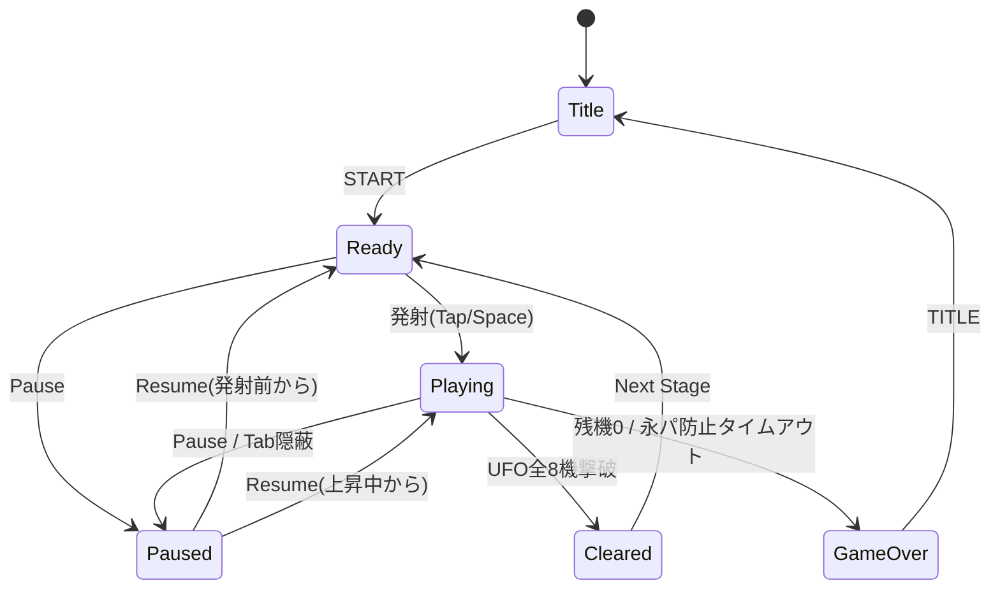

# 『ギャラクシーウォーズ』再現開発仕様書

* **版**：1.0（2026-10-26）
* **対象**：1979年アーケード名作『ギャラクシーウォーズ』（ユニバーサル／タイトー）の完全再現Webアプリ（HTML5 Canvas 2D / PWA / タッチ・PC両対応）を開発・再現するための全製品・実装仕様書。
* **位置づけ**：ソースコードおよび動作環境を再現するために必要なすべてのゲーム物理、スコア計算、基板挙動差、サウンド合成、PWA設計を網羅した本質的開発仕様書。

---

## 仕様書 目次

### 第 1 部 製品仕様（Product Specification）
1. [概要](#1-概要)
2. [フィールドと座標系](#2-フィールドと座標系)
3. [ゲームオブジェクト](#3-ゲームオブジェクト)
4. [操作仕様](#4-操作仕様)
5. [ゲームの進行と物理](#5-ゲームの進行と物理)
6. [スコア＆エクステンド仕様](#6-スコア＆エクステンド仕様)
7. [状態遷移](#7-状態遷移)
8. [画面仕様＆メッセージ演出](#8-画面仕様＆メッセージ演出)
9. [ハイスコアランキング＆保存](#9-ハイスコアランキング＆保存)
10. [非機能要件](#10-非機能要件)
11. [パラメータ一覧](#11-パラメータ一覧)
12. [受け入れ基準](#12-受け入れ基準)

### 第 2 部 実装仕様（Implementation Specification）
13. [開発環境](#13-開発環境)
14. [技術構成](#14-技術構成)
15. [プロジェクトの設定](#15-プロジェクトの設定)
16. [ファイル構成とアーキテクチャ層](#16-ファイル構成とアーキテクチャ層)
17. [主なデータ型と関数](#17-主なデータ型と関数)
18. [画面の骨組みとルーティング](#18-画面の骨組みとルーティング)
19. [描画・カラーパレット・被弾演出](#19-描画・カラーパレット・被弾演出)
20. [入力エンジン](#20-入力エンジン)
21. [端末内保存実装](#21-端末内保存実装)
22. [Web Audio 音色合成仕様](#22-web-audio-音色合成仕様)
23. [PWA・オフライン・起動復旧](#23-pwa・オフライン・起動復旧)
24. [テスト・CI・公開](#24-テスト・ci・公開)
25. [再現の確認基準](#25-再現の確認基準)

---

# 第 1 部 製品仕様

## 1. 概要
1979年にユニバーサルより登場しタイトーからもライセンス販売された固定画面シューティングゲーム『ギャラクシーウォーズ』を、スマートフォンの縦画面およびPCブラウザ上で動作するPWAアプリとして完全再構築する。
自機から弾を撃つのではなく「プレイヤーが誘導ミサイル（自機）そのものを操作して敵UFOに体当たりする」独特の操作感と緊迫感を忠実に再現する。

### 1.1 範囲
* **製品範囲**：ゲーム物理・判定、操作系、スコア体系、基板バージョン差（ユニバーサル版／タイトー版）、擬似カラー表示、Web Audio音色合成、PWAオフライン対応、端末内ハイスコアランキング。
* **選定可能要素**：グラフィック表示方式（ピクセルパーフェクト描画 / 擬似カラーセロハンシェーダー切替）。

### 1.2 前提条件
* **決定性**：乱数要素を排除し、固定タイムステップ（1/120秒）による物理計算を採用。同一入力列からは必ず同一のゲーム展開およびスコアが得られること。
* **通信仕様**：サーバー通信を行わず、ハイスコアおよび設定値はすべて端末内（localStorage）に完結して保存する。
* **想定端末**：スマホ縦画面（3:4レトロ比率維持）を基本とし、タッチ操作（操作空間）およびPCキーボード/マウス操作に対応。

---

## 2. フィールドと座標系
物理計算および描画の基準として、幅 480 × 高さ 640 の論理座標系を使用する。

```
x=0                                        x=480
┌──────────────────────────────────────────┐ y=0
│ SCORE : 00000        HIGH : 03000        │  HUD 帯 (y=0〜48)
├──────────────────────────────────────────┤ y=48 (天井)
│  UFO 上段 (右移動)  🛸  🛸  🛸  🛸       │ y=64〜88
│  UFO 下段 (左移動)  🛸  🛸  🛸  🛸       │ y=96〜120
│ ──────────────────────────────────────── │
│         🪨     🪨     🪨     🪨           │ 隕石 往復領域
│      🪨     🪨     🪨     🪨              │ (y=120〜560)
│                                          │
│                    🚀 (誘導ミサイル)     │
│ ──────────────────────────────────────── │
│                [ 🚀 ] (発射台)           │ y=580〜612 最下段待機・移動域
└──────────────────────────────────────────┘ y=640 (最下端)

┌──────────────────────────────────────────┐
│        ここをなぞって移動 / タップで発射 │ 操作空間 (タッチ端末用: 高さ96)
└──────────────────────────────────────────┘
```

### 2.1 領域構成
| 領域 | y範囲 | 説明 |
| :--- | :--- | :--- |
| **HUD帯** | 0 – 48 | スコア、ハイ antennae・残機表示領域 |
| **UFO通過領域** | 48 – 120 | 上段4機（右移動）、下段4機（左移動）が往復する |
| **隕石往復領域** | 120 – 580 | 隕石が牛耕式パターン（左右往復＋降下）で移動する |
| **発射台待機領域** | 580 – 612 | 発射台（ランチャー）および発射前ミサイルの待機・横移動領域 |
| **操作空間** | フィールド外 (高さ96) | タッチ操作用入力エリア（指で画面が隠れるのを防止） |

---

## 3. ゲームオブジェクト

### 3.1 発射台（ランチャー）および誘導ミサイル（自機）
* **寸法**: 発射台 幅 48 × 高さ 16 px / ミサイル 幅 12 × 高さ 24 px
* **発射前挙動**:
  * 画面最下部（y = 596）で発射台上に固定。レバー左右操作で横移動。
  * 最下段を走る隕石の高度は発射前ミサイルの先端（y = 584）と重なるため、発射を躊躇すると隕石に接触してミスとなる。
* **発射後挙動（誘導ミサイル操作）**:
  * **通常上昇（噴射ボタン非押下）**:
    * ジェット音なし・バックファイア描画なし。
    * 横移動速度：低速（UFO残り6機時の横移動速度と同等：120 px/秒）。
  * **加速噴射（噴射ボタン押下）**:
    * ジェット音再生・バックファイアアニメーション描画あり。
    * 横移動速度：高速（UFO残り2機時の横移動速度と同等：240 px/秒）。
    * 上昇速度：280 px/秒。
* **画面最上部到達**:
  * 敵や障害物に接触せず画面最上部（y < 48）へ抜けた場合、ミスにはならず、一定時間後に画面下部から発射台とともに再登場する。

### 3.2 敵UFO
* **配置**: 上段4機（右へ移動）、下段4機（左へ移動）の計8機。
* **移動速度**: 残存機数に応じて段階的に加速（8機: 80 px/秒 〜 残り1機: 320 px/秒）。
* **UFO光線（攻撃）**:
  * 画面内に最大3〜4発まで同時発射される「ニョロニョロ線（波動状光線）」。
  * クリア面が進むにつれて光線の落下速度が上昇する（1面: 180 px/秒 〜 面上昇毎に+20 px/秒）。

### 3.3 隕石群（障害物＆盾）
* **移動パターン（牛耕式 / Boustrophedon）**:
  * 画面両端で反転し、1段下がって逆方向へ進行。最下段到達後は最上段からループ登場。
* **左右速度差**:
  * 右方向移動速度（UFO 3機相当：180 px/秒）は左方向移動速度（UFO 6機相当：120 px/秒）より速い。
* **出現数の増加**:
  * 1面開始時は5個配置。1面クリアごとに1個ずつ増加し、28面で最大32個に到達（以降32個で固定）。
* **盾としての利用**:
  * 隕石はミサイルの障害物であると同時に、上空からのUFO光線を防ぐ防御壁（盾）として機能する。

### 3.4 隠し仕様・特殊判定（バグ技再現）
* **光線弾き（Reflect）**:
  * ミサイル先端中央〜やや斜めの判定範囲（横幅4px）で正面上方から敵光線を受けると、自機は無傷のまま光線を消失・弾き返す。

### 3.5 永久パターン防止機能
* ミサイル登場後、UFOを1機も撃破しないまま 1分30秒 経過すると残機が強制的に1に減少。
* さらに 1分 経過（計2分30秒経過）で強制ゲームオーバーとなる。

---

## 4. 操作仕様

### 4.1 操作デバイス対応
| 操作アクション | タッチ入力 | マウス / キーボード |
| :--- | :--- | :--- |
| **発射台・ミサイル横移動** | 操作空間またはフィールドのなぞり | マウス移動 / `←` `→` / `A` `D` |
| **ミサイル発射** | 操作空間またはフィールドのタップ | クリック / `Space` |
| **加速噴射** | 画面長押し（ボタン押下継続） | マウスボタン長押し / `Space` 保持 |
| **一時停止** | UI「Pause」ボタン | `P` / `Esc` |

---

## 5. ゲームの進行と物理

### 5.1 物理演算ループ
* 固定タイムステップ **1/120秒（約8.333ms）** で計算。
* フレーム落ちが発生しても最大の累積ステップ更新数は100ms（12ステップ）に制限し、すり抜け事故を防止する。

### 5.2 衝突判定優先順位
1. **ミサイル vs 隕石**: 接触時即座にミス判定（爆発エフェクト発生）。
2. **ミサイル vs UFO部位**: 判定部位に応じて得点加算し、UFO撃破。
3. **ミサイル vs UFO光線**: 光線弾き判定領域以外での接触時ミス判定。

---

## 6. スコア＆エクステンド仕様

### 6.1 部位別撃墜得点テーブル
| 面数 | 側面・上部 | 下部中央 | 下部突起部分（2ヶ所） |
| :--- | :--- | :--- | :--- |
| **1面** | 50点 | 100点 | 150点 |
| **2面** | 100点 | 200点 | 250点 |
| **3面** | 100点 | 300点 | 350点 |
| **4面** | 200点 | 400点 | 450点 |
| **5面以降** | 200点 | 500点 | 550点 |

### 6.2 600点ボーナスUFO
特定順番で撃墜するUFOの「突起部分」に命中させると、特別ボーナス **600点** が獲得できる。
* **1面**: 3機撃墜後、**4機目**のUFO突起
* **2面**: 4機撃墜後、**5機目**のUFO突起
* **3面**: 5機撃墜後、**6機目**のUFO突起
* **4面**: 6機撃墜後、**7機目**のUFO突起
* **5面以降**: 1面〜4面の順番パターンをループ

### 6.3 エクステンド（増機）
* 累計 **3,000点** 到達時に発射台（残機）が1基増機される。
* 残機UI表示にはミサイルではなく「発射台アイコン」を使用する。

---

## 7. 状態遷移



---

## 8. 画面仕様＆メッセージ演出

### 8.1 クリアメッセージ演出
各面クリア時、画面中央に伝統の評価メッセージを表示する。
* **3面クリア**: `GOOD!!`
* **7面クリア**: `VERY GOOD!!`
* **10面クリア**: `WONDERFUL!!`
* **15面クリア**: `FANTASTIC!!`
* **19面クリア（純正ユニバーサル版仕様）**: `NEXT IS HAPPY MESSAGE ???`
* **20面クリア（純正ユニバーサル版仕様）**: `EXCELLENT!!`
* **23面クリア（純正ユニバーサル版仕様）**: `NEVER GIVE UP!!`
* **33面クリア**: `GIVE UP!!` （※33面クリア後もゲームオーバーにならず34面へループ進行）

---

## 9. ハイスコアランキング＆保存

* 端末内保存（localStorage）を使用し、上位10件のランキング（スコア、プレイヤー名、到達面数、クリア日時）を管理。
* JSON書き出し／読み込み（バックアップ・復元）機能を標準搭載。

---

## 10. 非機能要件

1. **フレームレート**: 主要モバイルブラウザおよびPCにて60fpsを維持。
2. **決定性検証**: 乱数非使用により、入力再現ログで完全に同じ展開が再現可能。
3. **完全オフライン動作**: PWAキャッシュ機能により一度読み込み後は完全スタンドアロン動作。

---

## 11. パラメータ一覧

| パラメータ名 | 定数値 | 単位 | 説明 |
| :--- | :--- | :--- | :--- |
| `FIELD_WIDTH` | 480 | px | フィールド論理幅 |
| `FIELD_HEIGHT` | 640 | px | フィールド論理高さ |
| `MISSILE_SPEED_NORMAL` | 180 | px/秒 | ミサイル通常上昇速度 |
| `MISSILE_SPEED_BOOST` | 280 | px/秒 | 加速噴射時上昇速度 |
| `MISSILE_LATERAL_LOW` | 120 | px/秒 | 通常時横移動速度（UFO 6機相当） |
| `MISSILE_LATERAL_HIGH` | 240 | px/秒 | 加速時横移動速度（UFO 2機相当） |
| `EXTEND_SCORE` | 3000 | 点 | 初回増機スコア |
| `PERMANENT_TIMEOUT_1` | 90 | 秒 | 永パ防止第一段階（残機1化） |
| `PERMANENT_TIMEOUT_2` | 150 | 秒 | 永パ防止第二段階（強制終了） |

---

## 12. 受け入れ基準

* [ ] 発射台待機中のミサイル先端が隕石と接触してミスになること。
* [ ] ボタン押下による加速噴射時に音とバックファイアが発生し、横移動が高速化すること。
* [ ] ミサイル先端での光線受弾時に弾き（Reflect）が正しく発動すること。
* [ ] 33面クリア時に `GIVE UP!!` が表示され、終了せず34面へ進行すること。
* [ ] 3,000点到達時に増機音が鳴り、発射台アイコンが増加すること。

---

# 第 2 部 実装仕様

## 13. 開発環境
* **OS**: クロスプラットフォーム (Node.js 24系)
* **パッケージ管理**: npm
* **ビルドツール**: Vite ^8.3.4
* **言語**: TypeScript ~6.0.3 (Strict Mode)

---

## 14. 技術構成
* **描画**: HTML5 Canvas 2D API (2D Context)
* **音源**: Web Audio API (オシレーター直打ち合成音)
* **PWA**: vite-plugin-pwa (Workbox / Service Worker)
* **テスト**: Vitest (ロジック単体テスト), Playwright (E2Eテスト)

---

## 15. プロジェクトの設定

### `package.json` 構成案
```json
{
  "name": "galaxy-wars-reproduction",
  "version": "1.0.0",
  "private": true,
  "type": "module",
  "scripts": {
    "dev": "vite",
    "build": "tsc --noEmit && vite build",
    "preview": "vite preview",
    "test": "vitest run",
    "test:e2e": "playwright test"
  }
}
```

---

## 16. ファイル構成とアーキテクチャ層

```
src/
├── core/                  # ロジック層（純粋関数・決定性・DOM依存なし）
│   ├── config.ts          # システムパラメータ定数
│   ├── game.ts            # ゲーム状態管理・メインステップ更新
│   ├── physics.ts         # 衝突判定・光線弾き・牛耕式移動アルゴリズム
│   ├── scoring.ts         # 部位別スコア・600点ボーナス計算
│   └── sound-plan.ts     # 各フレームの再生イベントキュー計画
├── render/                # 画面描画層
│   ├── canvas.ts          # Canvas 2D 描画エンジン
│   ├── color-palette.ts   # 擬似カラーセロハン・被弾フラッシュ制御
│   └── sprites.ts         # UFO・ミサイル・隕石・フォント描画
├── audio/                 # 音響層
│   └── synthesizer.ts     # Web Audio API オシレーター合成器
├── storage/               # 基盤層
│   └── ranking-store.ts   # localStorage & JSON バックアップ機能
└── main.ts                # アプリケーションエントリーポイント
```

---

## 17. 主なデータ型と関数

### `src/core/game.ts`
```typescript
export type GameStatus = 'ready' | 'playing' | 'paused' | 'cleared' | 'gameOver';

export interface Missile {
  x: number;
  y: number;
  vx: number;
  vy: number;
  isBoosting: boolean;
  isLaunched: boolean;
}

export interface UFO {
  id: number;
  x: number;
  y: number;
  row: 0 | 1; // 0: 上段(右移動), 1: 下段(左移動)
  isAlive: boolean;
}

export interface Meteor {
  x: number;
  y: number;
  direction: 1 | -1; // 1: 右, -1: 左
}

export interface GameState {
  status: GameStatus;
  stage: number;
  score: number;
  highScore: number;
  lives: number; // 発射台残数
  missile: Missile;
  ufos: UFO[];
  meteors: Meteor[];
  beams: { x: number; y: number; vy: number }[];
  idleTimerMs: number; // 永久パターン防止タイマー
}
```

---

## 18. 画面の骨組みとルーティング

HTML5シングルページアプリ構造とし、`#/title`, `#/play`, `#/ranking` のハッシュルーティングで画面遷移を制御する。

---

## 19. 描画・カラーパレット・被弾演出

### 被弾時フラッシュ制御
* **ユニバーサルモード**: 被弾時に画面全体を `#0000FF` (青) で 100ms フラッシュ。
* **タイトーモード**: 被弾時に画面全体を `#FF0000` (赤) で 100ms フラッシュ。

### 擬似カラーセロハン再現シェーダー (Canvas Composite)
* 画面上部 (UFO域): 紫/赤系 オーバーレイ
* 画面中央 (隕石域): 透明/白系
* 画面下部 (発射台域): 緑系 オーバーレイ

---

## 20. 入力エンジン

Pointer Events API を採用し、タッチ端末ではゲームエリア下の「操作空間」でのスライド操作を論理 `x` 座標へと変換し、ミサイル発射台を追従させる。

---

## 21. 端末内保存実装

`localStorage` キー `galaxy-wars-scores` に上位10件の記録をJSON化して保持。バックアップJSONフォーマット構造を標準提供。

---

## 22. Web Audio 音色合成仕様

オリジナルアーケード基板の4系統音源をオシレーターでリアルタイム合成。

| 効果音 | オシレーター波形 | 周波数・変化仕様 |
| :--- | :--- | :--- |
| **ミサイル上昇音** | 矩形波 (Square) | 440 Hz → 880 Hz ピッチ上昇スイープ |
| **UFO破壊音** | ノイズ / 鋸波 | ホワイトノイズ＋低音減衰（120 Hz → 30 Hz） |
| **エクステンド音** | 三角波 (Triangle) | 523 Hz → 659 Hz → 784 Hz アルペジオ |
| **ミス爆発音** | 低音ノイズ | 重低音ノイズ＋爆発エンベロープ |

---

## 23. PWA・オフライン・起動復旧

`vite-plugin-pwa` を使用し、全静的アセットを Service Worker でキャッシュ。8秒以上ロードが完了しない場合の起動復旧ダイアログ（`boot.js`）を組み込む。

---

## 24. テスト・CI・公開

* **Vitest**: 衝突判定およびスコア計算の決定性テスト。
* **GitHub Actions**: 自動ビルド、Lint、E2Eテスト、GitHub Pages自動デプロイ。

---

## 25. 再現の確認基準

* [ ] 第1部 §12 のすべての受け入れ基準を満たすこと。
* [ ] 外部CDNや外部ネットワークアクセスなしで完全オフライン動作すること。
* [ ] 固定タイムステップ (1/120s) の物理整合性が実機スマートフォンで証明されること。
