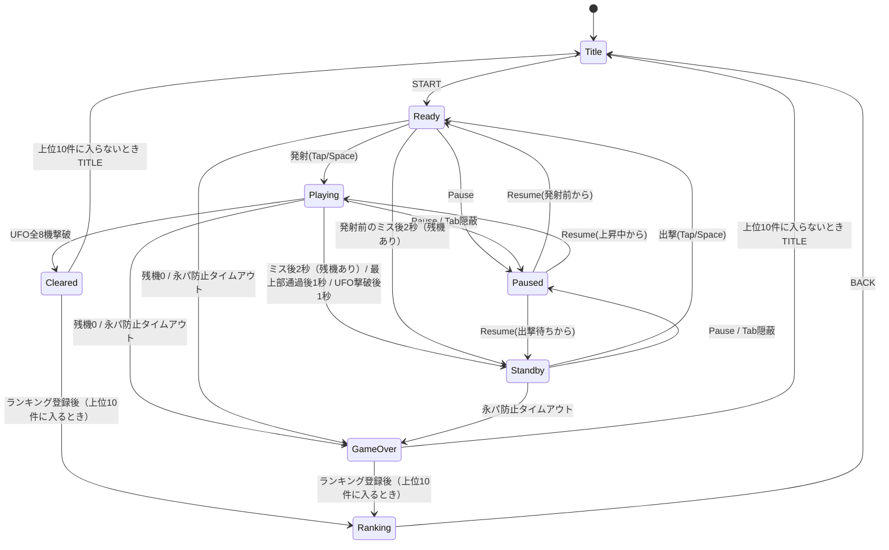

# 『ギャラクシーウォーズ』再現開発仕様書（銀河戦争ミニ 1.0.0）

* **版**：1.0（2026-10-30）
* **基にしたもの**：第 1 部は doc/specification.md (v1.11) の第 1 部（§1〜§12）と同じ。第 2 部は main の実装（アプリの版 1.0.0）に合わせた。
* **位置づけ**：この 1 冊だけで、同じアプリを作り直せるようにする。製品として何を作るか（第 1 部）と、どう作ったか（第 2 部）。
* **公開 URL**：https://tsuku3dayo.github.io/mini-galaxywars-game/
* **直し方**：仕様書を変えたときは第 1 部を同じに直し、実装を変えたときは第 2 部の値を main に合わせる（doc/workflow.txt の【完了】）。

## 改訂履歴

| 版 | 日付 | 内容 |
| :--- | :--- | :--- |
| 1.0 | 2026-10-30 | 初版（仕様書 v1.11、アプリ 1.0.0） |

## 目次

### 第 1 部 製品仕様
1. [概要](#1-概要)
2. [フィールドと座標系](#2-フィールドと座標系)
3. [ゲームオブジェクト](#3-ゲームオブジェクト)
4. [操作仕様](#4-操作仕様)
5. [ゲームの進行と物理](#5-ゲームの進行と物理)
6. [スコア＆エクステンド仕様](#6-スコア＆エクステンド仕様)
7. [状態遷移](#7-状態遷移)
8. [画面仕様＆メッセージ演出](#8-画面仕様＆メッセージ演出)
9. [ハイスコアランキング＆保存](#9-ハイスコアランキング＆保存)
10. [非機能要件](#10-非機能要件)
11. [パラメータ一覧](#11-パラメータ一覧)
12. [受け入れ基準](#12-受け入れ基準)

### 第 2 部 実装仕様
13. [開発環境](#13-開発環境)
14. [技術構成](#14-技術構成)
15. [プロジェクトの設定](#15-プロジェクトの設定)
16. [ファイル構成とアーキテクチャ層](#16-ファイル構成とアーキテクチャ層)
17. [主なデータ型と関数](#17-主なデータ型と関数)
18. [画面の骨組みとルーティング](#18-画面の骨組みとルーティング)
19. [描画・カラーパレット・被弾演出](#19-描画・カラーパレット・被弾演出)
20. [入力エンジン](#20-入力エンジン)
21. [端末内保存実装](#21-端末内保存実装)
22. [Web Audio 音色合成仕様](#22-web-audio-音色合成仕様)
23. [PWA・オフライン・起動復旧](#23-pwa・オフライン・起動復旧)
24. [テスト・CI・公開](#24-テスト・ci・公開)
25. [再現の確認基準](#25-再現の確認基準)

---

# 第 1 部 製品仕様

## 1. 概要
1979年にユニバーサルより登場しタイトーからもライセンス販売された固定画面シューティングゲーム『ギャラクシーウォーズ』を、スマートフォンの縦画面およびPCブラウザ上で動作するPWAアプリとして完全再構築する。
自機から弾を撃つのではなく「プレイヤーが誘導ミサイル（自機）そのものを操作して敵UFOに体当たりする」独特の操作感と緊迫感を忠実に再現する。
本アプリ（銀河戦争ミニ）で遊べるのは **1面のみ** とし、1面クリアでゲームを終える。

### 1.1 範囲
* **製品範囲**：ゲーム物理・判定、操作系、スコア体系、タイトー版の挙動（固定）、擬似カラー表示、Web Audio音色合成、PWAオフライン対応、端末内ハイスコアランキング、クレジット画面。
* **選定可能要素**：グラフィック表示方式（ピクセルパーフェクト描画 / 擬似カラーセロハンシェーダー切替）、効果音のオン・オフ。
* **速さ**：ミサイル・発射台・UFO・隕石の速さは原作の 1/4、光線の落ちる速さは 1/2 にしてある（スマートフォンで遊びやすくするため。原作の値は doc/galaxy_wars_spec.md）。
* **範囲外**：2面以降（面の進行による難易度変化・面別得点表・面別クリアメッセージ）。ユニバーサル版の挙動と、基板の版の切り替え。

### 1.2 前提条件
* **決定性**：固定タイムステップ（1/120秒）による物理計算を採用。乱数は、ゲームを始めるときに決める種（シード）から決まった式で作り、隕石の初めの並び（§3.3）だけに使う。同一の種と同一入力列からは必ず同一のゲーム展開およびスコアが得られること。
* **通信仕様**：サーバー通信を行わず、ハイスコアおよび設定値はすべて端末内（localStorage）に完結して保存する。
* **想定端末**：スマホ縦画面（3:4レトロ比率維持）を基本とし、タッチ操作（操作空間）およびPCキーボード/マウス操作に対応。

---

## 2. フィールドと座標系
物理計算および描画の基準として、幅 480 × 高さ 640 の論理座標系を使用する。

```
x=0                                        x=480
┌──────────────────────────────────────────┐ y=0
│ SCORE : 00000        HIGH : 03000        │  HUD 帯 (y=0〜48、スコアとハイスコア)
├──────────────────────────────────────────┤ y=48 (天井)
│  UFO 上段 (右移動)  🛸  🛸  🛸  🛸       │ y=64〜88
│  UFO 下段 (左移動)  🛸  🛸  🛸  🛸       │ y=96〜120
│ ──────────────────────────────────────── │
│         🪨     🪨     🪨     🪨           │ 隕石 往復領域
│      🪨     🪨     🪨     🪨              │ (y=120〜548)
│                                          │
│                    🚀 (誘導ミサイル)     │
│ ──────────────────────────────────────── │
│                [ 🚀 ] (発射台)           │ y=580〜616 最下段待機・移動域
│ ════════════════════════════════════════ │ y=616〜618 地面
│ 3 ▲▲                                     │ y=620〜636 残機（数と控えの発射台）
└──────────────────────────────────────────┘ y=640 (最下端)

╭──────────────────────────────────────────╮
│      ここをなぞって移動・タップで発射    │ 操作空間 (タッチ端末用: 高さ96、角の丸い枠)
╰──────────────────────────────────────────╯
 [ ‖ 一時停止 ]              [ 🔊 効果音：オン ]
```

### 2.1 領域構成
| 領域 | y範囲 | 説明 |
| :--- | :--- | :--- |
| **HUD帯** | 0 – 48 | スコア・ハイスコアの表示領域 |
| **UFO通過領域** | 48 – 120 | 上段4機（右移動）、下段4機（左移動）が往復する（画面の端を出たら反対の端から出る。§3.2） |
| **隕石往復領域** | 120 – 580 | 隕石が牛耕式パターン（左右往復＋降下）で移動する |
| **発射台待機領域** | 580 – 616 | 発射台（ランチャー）および発射前ミサイルの待機・横移動領域 |
| **地面** | 616 – 618 | 発射台の下の横線 |
| **残機表示** | 620 – 636 | 左下に残機の数と、控えの発射台のアイコン（§6.3） |
| **操作空間** | フィールド外 (高さ96) | タッチ操作用入力エリア（指で画面が隠れるのを防止）。角の丸い枠で囲み、中に「ここをなぞって移動・タップで発射」と出す。下に一時停止と効果音のボタン |

* フィールドにも細い枠を付ける。

---

## 3. ゲームオブジェクト

### 3.1 発射台（ランチャー）および誘導ミサイル（自機）
* **寸法**: 発射台 幅 48 × 高さ 16 px / ミサイル 幅 12 × 高さ 24 px
* **位置**: 物の位置は中心の座標で表す。発射台の中心は y = 608（上端 600〜下端 616。ミサイルの下の部分が発射台に差し込まれた形）。
* **発射前挙動**:
  * 画面最下部（y = 596）で発射台上に固定。レバー左右操作で横移動。
  * 発射台の中心 x は 24〜456 で、画面の端で止まる。横の速さは、キーで 60 px/秒、指・マウスの x へ近づくときは上限 120 px/秒。
  * 隕石の最下段（y = 536）は発射前ミサイルの先端（y = 584）より上を通り、発射前のミサイルには当たらない（§3.3）。
  * 発射はタップだけ（§4.1）。なぞって発射台を動かしてから指を離しても発射しない。
* **発射後挙動（誘導ミサイル操作）**:
  * 発射したら、発射台は描かない（発射台に当たりがあるのは発射前だけ。§5.2）。
  * **通常上昇（噴射ボタン非押下）**:
    * 噴射音なし・バックファイア描画なし。
    * 横移動速度：低速（UFO残り6機時の横移動速度と同等：30 px/秒）。
    * 上昇速度：45 px/秒。
  * **加速噴射（噴射ボタン押下）**:
    * 噴射音再生・バックファイアアニメーション描画あり。
    * 横移動速度：高速（UFO残り2機時の横移動速度と同等：60 px/秒）。
    * 上昇速度：70 px/秒。
  * ミサイルの中心 x は 6〜474 で止まる。
* **画面最上部到達**:
  * 敵や障害物に接触せず画面最上部（y < 48）へ抜けた場合、ミスにはならず、1秒後に出撃待ちになる（残機は減らない）。
  * 「抜けた」は、ミサイルの下端が y = 48 より上に出たとき。
* **UFO撃破時**:
  * UFOに当たったら、ミサイルはそこで消える（1回の発射で倒せるのは1機）。1秒後に出撃待ちになる（最上部を抜けたときと同じ。残機は減らない）。8機目を倒したときはクリア。
* **出撃待ち（再出撃）**:
  * ミス（2秒）・最上部通過（1秒）・UFO撃破（1秒）の待ちのあと、すぐには発射台を出さず、出撃待ちになる。画面に「タップで出撃」と出す。
  * タップ・クリック・`Space` で、発射台が出て発射前の状態に戻る。このタップでは発射しない。
  * 発射台の出る位置：タップ・クリックしたときは、その x（画面の端で止める。24〜456）。`Space` のときは、マウスの x があればその x、なければ x = 240（仕様書 v1.10）。
  * 出撃待ちの間、UFO・隕石・落ちている光線は動き続ける。UFOは光線を撃たない。発射台がないので、当たる物もない。
  * ゲームの初めの1基は、出撃待ちを通らず、すぐ発射前になる。

### 3.2 敵UFO
* **配置**: 上段4機（右へ移動、中心 y = 76）、下段4機（左へ移動、中心 y = 108）の計8機。大きさは 32 × 24。両段とも x = 60・180・300・420 から始める。
* **画面端**: 段ごとに向きは変わらない。画面の端を出たら、反対の端から出る。
* **移動速度**: 残存機数に応じて段階的に加速する。

  | 残存機数 | 8 | 7 | 6 | 5 | 4 | 3 | 2 | 1 |
  | :--- | :--- | :--- | :--- | :--- | :--- | :--- | :--- | :--- |
  | 速度（px/秒） | 20 | 25 | 30 | 35 | 40 | 45 | 60 | 80 |

* **絵**: 2コマの絵を0.25秒ごとに切り替える（羽ばたくように見せる）。8機とも同じ時に切り替える。光線も2コマの絵を、UFOと同じ時に切り替える。光線の2コマは、幅1点の細い波と、それを左右に裏返した波（オーナーの画像「銀河戦争ミニ_弾1・弾2」。仕様書 v1.10）。
* **UFO光線（攻撃）**:
  * 「ニョロニョロ線（波動状光線）」を真下へ撃つ。
  * 0.75秒ごとに、ミサイル（発射前は発射台）との横の距離がいちばん近いUFOが1発撃つ（乱数は使わない）。
  * 画面内に同時に出せるのは、UFOの残存機数が5機以上なら3発、4機以下なら4発。上限に達しているときは撃たない。
  * 光線の落下速度は 90 px/秒（1面の値で固定）。光線の大きさは 4 × 16。
  * 距離がいちばん近いUFOが2機以上あるときは、下段を先に、それでも同じなら番号（上段の左から0〜3、下段4〜7）の小さい方が撃つ。
  * 光線はUFOの真下から出る。発射台がいない間（ミス・最上部通過・UFO撃破のあとの待ちと、出撃待ち）は撃たない。

### 3.3 隕石群（障害物＆盾）
* **大きさ**: 24 × 24（当たりの四角は 20 × 20）。
* **尾**: 進む向きの後ろに、3本の横線の尾（幅 8）を描く。尾には当たりはない。尾も2コマの絵を、UFOと同じ時に0.25秒ごとに切り替える（1コマ目は3本とも長さ8、2コマ目は上下の線を長さ6。仕様書 v1.10）。
* **移動パターン（牛耕式 / Boustrophedon）**:
  * 画面両端で反転し、1段下がって逆方向へ進行。最下段到達後は最上段からループ登場。
  * 段は11段（中心 y = 136 + 40 × 段。最下段は 536）。中心 x が 12 と 468 で向きを変えて1段下がる。最上段は右へ進み、段ごとに向きが入れ替わる。
  * 初めの並び：ゲームを始めるたびに、11段で1周する道のりの上に、種（§1.2）から決めた位置で5個を置く。となりどうしの間は、道のりの1/10以上空ける（重なって見えないように）。
* **左右速度差**:
  * 右方向移動速度（UFO 3機相当：45 px/秒）は左方向移動速度（UFO 6機相当：30 px/秒）より速い。
* **出現数**:
  * 5個配置（1面の値で固定）。
* **盾としての利用**:
  * 隕石はミサイルの障害物であると同時に、上空からのUFO光線を防ぐ防御壁（盾）として機能する。

### 3.4 隠し仕様・特殊判定（バグ技再現）
* **光線弾き（Reflect）**:
  * ミサイル先端中央〜やや斜めの判定範囲（横幅4px）で正面上方から敵光線を受けると、自機は無傷のまま光線を弾き返す。弾かれた光線は向きを変えて上へ飛び、画面の上で消える。UFOには当たらない。
  * 弾く条件：光線の中心 x がミサイルの中心から ±2 px 以内（先端の中央・横幅 4 px）で、直前のステップで光線の下端がミサイルの先端より上にあった（正面の上から来た）。ミサイルが横に動いていても（やや斜め）、発射前でも弾く。

### 3.5 永久パターン防止機能
* ミサイル登場後、UFOを1機も撃破しないまま 1分30秒 経過すると残機が強制的に1に減少。
* さらに 1分 経過（計2分30秒経過）で強制ゲームオーバーとなる。
* タイマーが0に戻るのは、UFOを撃破したときだけ。ミスしても戻らない。出撃待ちの間も進む。

---

## 4. 操作仕様

### 4.1 操作デバイス対応
| 操作アクション | タッチ入力 | マウス / キーボード |
| :--- | :--- | :--- |
| **発射台・ミサイル横移動** | 操作空間またはフィールドのなぞり | マウス移動 / `←` `→` / `A` `D` |
| **ミサイル発射** | 操作空間またはフィールドのタップ | クリック / `Space` |
| **出撃（出撃待ちから）** | 操作空間またはフィールドのタップ | クリック / `Space` |
| **加速噴射** | 画面長押し（ボタン押下継続） | マウスボタン長押し / `Space` 保持 |
| **一時停止** | 「一時停止」ボタン | 「一時停止」ボタン / `P` / `Esc` |
| **効果音のオン・オフ** | 「効果音」ボタン | 「効果音」ボタン |

* タップ（クリック）は、指（マウスのボタン）を置いてから離すまでに動いた距離が 10 px（CSS の px）未満のもの。なぞって動かしてから離しても、発射・出撃はしない。

---

## 5. ゲームの進行と物理

### 5.1 物理演算ループ
* 固定タイムステップ **1/120秒（約8.333ms）** で計算。
* フレーム落ちが発生しても最大の累積ステップ更新数は100ms（12ステップ）に制限し、すり抜け事故を防止する。

### 5.2 衝突判定優先順位
1. **ミサイル vs 隕石**: 接触時即座にミス判定（爆発エフェクト発生）。
2. **ミサイル vs UFO部位**: 判定部位に応じて得点加算し、UFO撃破。ミサイルは消える（§3.1）。
3. **ミサイル vs UFO光線**: 光線弾き判定領域以外での接触時ミス判定。発射前の発射台に光線が当たってもミス。

* 当たり判定は四角どうしの重なりで調べる。辺が接しただけは当たりにしない。
* ミスかクリアが決まったら、そのステップの残りの判定はしない。

---

## 6. スコア＆エクステンド仕様

### 6.1 部位別撃墜得点テーブル
| 側面・上部 | 下部中央 | 下部突起部分（2ヶ所） |
| :--- | :--- | :--- |
| 50点 | 100点 | 150点 |

（1面の値。2面以降は範囲外）

部位の四角（UFOの中心からの範囲）：

| 部位 | x | y |
| :--- | :--- | :--- |
| 側面・上部 | −16〜16 | −12〜4 |
| 下部中央 | −6〜6 | 0〜8 |
| 下部突起部分 | −14〜−8 と 8〜14 | 4〜12 |

* ミサイルが重なった部位のうち、得点の高い方を取る。
* 倒したUFOの位置に、爆発の絵を0.4秒出し、そのあと同じ位置に入った得点（`50`・`100`・`150`・`600`）を、倒してから1秒まで出す。

### 6.2 600点ボーナスUFO
特定順番で撃墜するUFOの「突起部分」に命中させると、特別ボーナス **600点** が獲得できる。
* 3機撃墜後、**4機目**のUFO突起（1面の値）
* 600点は、突起の150点の代わりに入る。

### 6.3 エクステンド（増機）
* ゲーム開始時の発射台（残機）は **3基**（画面に出ている1基を含む）。
* 累計 **1,000点** 到達時に発射台（残機）が1基増機される。増機は1回だけ。
* 残機は画面の左下（地面の下）に、残機の数（画面に出ている1基を含む）と、控えの発射台のアイコン（数 − 1 個）で出す。アイコンはミサイルではなく発射台の形。
* スコアは 99,999 で止める。
* 時間ボーナス（§6.4）は、クリアしたときに足すので、増機には使わない。

### 6.4 時間ボーナス（仕様書 v1.9）
早くクリアするほど増えるボーナス（「ブロック崩しミニ」と同じ考え方）。

| 項目 | 計算 |
| :--- | :--- |
| UFO の得点 | §6.1〜§6.3 のとおり（1面で 400〜1,650） |
| 時間ボーナス | クリアしたとき：max(0, 180 − 経過秒（小数点以下切り捨て）) × 5。ゲームオーバーのとき：0 |
| 合計スコア | UFO の得点 + 時間ボーナス（99,999 で止める） |

* 基準は 180 秒（`TIME_BONUS_BASE`）で、1 秒早いごとに 5 点（`TIME_BONUS_PER_SEC`）増える。180 秒以上かかると 0。
* **経過時間**：ミサイルが飛んでいる間（Playing）だけ、1 ステップ（1/120 秒）ごとに数える。発射前（Ready）・待ち（Respawn）・出撃待ち（Standby）・一時停止（タブが隠れて止まったときを含む）は数えない。1 回の描画で進むのは最大 12 ステップ（§5.1）なので、一度に大きく進まない。
* 例：経過 95.7 秒（11,484 ステップ）でクリア → 経過秒は 95 → (180 − 95) × 5 = 425。UFO の得点が 1,150 なら合計 1,575。

---

## 7. 状態遷移



* ミス時は爆発エフェクトと被弾フラッシュを出し、2秒後に出撃待ち（Standby）になる。タップで次の発射台が登場して発射前（Ready）に戻る（§3.1）。撃破済みのUFOは復活しない。隕石は動き続ける。爆発の絵は0.4秒。
* 最後の1基でミスしたときも、2秒待ってからゲームオーバーにする（出撃待ちにはしない）。
* ランキングに登録したあとは、ランキング画面を開き、今登録した記録を目立たせる（§9）。

---

## 8. 画面仕様＆メッセージ演出

### 8.1 クリアメッセージ演出
1面クリア（UFO全8機撃破）時、画面中央にクリアの表示を出し、ゲームを終えてランキング登録へ進む。
* クリアの表示の文言は画面設計（03）で決める。
* クリアの表示の下に、UFO の得点・タイム（経過秒を小数第 1 位で切り捨て。例 `95.7`）・時間ボーナス・合計を出す（§6.4）。ゲームオーバーの表示には出さない。
* 原作の面別評価メッセージ（3面 `GOOD!!` 〜 33面 `GIVE UP!!`）は範囲外。

---

## 9. ハイスコアランキング＆保存

* 端末内保存（localStorage）を使用し、上位10件のランキング（スコア、プレイヤー名、日時、結果（クリア・ゲームオーバー）、クリアのタイム）を管理。登録するスコアは合計スコア（§6.4）。
* クリアかゲームオーバーでゲームが終わり、スコアが上位10件に入るとき、名前を入れて登録する。入らないときは登録しない。0点は登録しない。
* 同じスコアは、先に登録した方を上にする。
* 名前の入力欄は、全角の文字（日本語・全角数字）が8文字見える幅にする（仕様書 v1.10）。
* 名前は1〜8文字。ひらがな・カタカナ・漢字・英数字・記号・空白を使える（大文字には直さない）。改行などの制御文字は使えない。前後の空白は取り、空のときは `PLAYER`。日本語の変換の途中（確定する前）は文字を削らない。
* JSON書き出し／読み込み（バックアップ・復元）機能を標準搭載。
* **ランキング画面**（「ブロック崩しミニ」と同じ形）：
  * 上に「← BACK」とタイトル「ハイスコアランキング」。スクロールしても上に残る。
  * 表は「順位・名前・スコア」。1〜3位は `1st`・`2nd`・`3rd` を黄色で、4位からは数字。名前の下に小さく、結果（`CLEAR` か `GAME OVER`）と日時（`2026/10/25 21:13`）。クリアの記録は、結果のあとにタイム（`CLEAR · 95.7 秒 · 2026/10/25 21:13`）。結果やタイムのない前からの記録は、あるものだけ出す。
  * 一番下に「記録のバックアップ」の枠と、「記録を書き出す」「記録を読み込む」のボタン。
  * 登録したあとに開いたときは、今登録した記録の行を黄色の線と背景で目立たせ、名前に「（あなた）」を付ける。
* **全消去**：タイトル画面の「ランキング消去」で、確認（「ランキングをすべて消します。元に戻せません。よろしいですか？」・「消す」「やめる」）のあと、すべての記録を消す。記録がないときは「記録がありません」と出す。消したあと、タイトルの HIGH は 0。

---

## 10. 非機能要件

1. **フレームレート**: 主要モバイルブラウザおよびPCにて60fpsを維持。
2. **決定性検証**: 乱数は種から決まった式で作るので、種と入力再現ログで完全に同じ展開が再現可能。
3. **完全オフライン動作**: PWAキャッシュ機能により一度読み込み後は完全スタンドアロン動作。

---

## 11. パラメータ一覧

| パラメータ名 | 定数値 | 単位 | 説明 |
| :--- | :--- | :--- | :--- |
| `FIELD_WIDTH` | 480 | px | フィールド論理幅 |
| `FIELD_HEIGHT` | 640 | px | フィールド論理高さ |
| `MISSILE_SPEED_NORMAL` | 45 | px/秒 | ミサイル通常上昇速度 |
| `MISSILE_SPEED_BOOST` | 70 | px/秒 | 加速噴射時上昇速度 |
| `MISSILE_LATERAL_LOW` | 30 | px/秒 | 通常時横移動速度（UFO 6機相当） |
| `MISSILE_LATERAL_HIGH` | 60 | px/秒 | 加速時横移動速度（UFO 2機相当） |
| `UFO_SPEEDS` | 20, 25, 30, 35, 40, 45, 60, 80 | px/秒 | UFO横移動速度（残存8機〜1機） |
| `BEAM_SPEED` | 90 | px/秒 | UFO光線の落下速度 |
| `BEAM_INTERVAL` | 0.75 | 秒 | UFO光線の発射間隔 |
| `BEAM_MAX` | 3 / 4 | 発 | 光線の同時数（UFO 5機以上 / 4機以下） |
| `INITIAL_LIVES` | 3 | 基 | 開始時の発射台数（画面上の1基を含む） |
| `MISS_RESPAWN` | 2 | 秒 | ミスから次の発射台登場まで |
| `EXIT_RESPAWN` | 1 | 秒 | 最上部通過・UFO撃破から発射台再登場まで |
| `EXTEND_SCORE` | 1000 | 点 | 増機スコア（1回のみ） |
| `PERMANENT_TIMEOUT_1` | 90 | 秒 | 永パ防止第一段階（残機1化） |
| `PERMANENT_TIMEOUT_2` | 150 | 秒 | 永パ防止第二段階（強制終了） |
| `LAUNCHER_Y` | 608 | px | 発射台の中心 y |
| `LAUNCHER_KEY_SPEED` | 60 | px/秒 | キーでの発射台の横移動速度 |
| `LAUNCHER_POINTER_SPEED` | 120 | px/秒 | 指・マウスの x へ近づく発射台の速度の上限 |
| `UFO_SIZE` | 32 × 24 | px | UFOの大きさ |
| `BEAM_SIZE` | 4 × 16 | px | 光線の大きさ |
| `REFLECT_WIDTH` | 4 | px | 光線弾きの判定範囲（先端の中央 ±2） |
| `METEOR_SIZE` | 24（当たり 20） | px | 隕石の大きさ |
| `METEOR_SPEED_RIGHT` | 45 | px/秒 | 隕石の右向きの速さ（UFO 3機相当） |
| `METEOR_SPEED_LEFT` | 30 | px/秒 | 隕石の左向きの速さ（UFO 6機相当） |
| `METEOR_LANES` | 11 | 段 | 隕石の段の数（y = 136 + 40 × 段） |
| `EXPLOSION_TIME` | 0.4 | 秒 | 爆発の絵を出す長さ（ミス・UFO撃破） |
| `UFO_FRAME_TIME` | 0.25 | 秒 | UFO・光線の2コマを切り替える間隔 |
| `METEOR_MIN_GAP` | 1/10 | 道のり | 隕石の初めの並びで、となりどうしの間の最小（1周の道のりに対する割合） |
| `TAP_SLOP` | 10 | CSS px | タップとみなす、置いてから離すまでに動いた距離の上限（未満） |
| `SCORE_MAX` | 99999 | 点 | スコアの上限 |
| `TIME_BONUS_BASE` | 180 | 秒 | 時間ボーナスの基準（これ以上かかると 0） |
| `TIME_BONUS_PER_SEC` | 5 | 点 | 1 秒早いごとに増える時間ボーナス |

---

## 12. 受け入れ基準

* [ ] ボタン押下による加速噴射時に音とバックファイアが発生し、横移動が高速化すること。
* [ ] ミサイル先端での光線受弾時に弾き（Reflect）が正しく発動すること。
* [ ] UFO全8機の撃破でクリアの表示が出てゲームが終わり、ランキング登録に進むこと。
* [ ] 1,000点到達時に増機音が鳴り、発射台アイコンが増加すること。
* [ ] クリアが早いほど時間ボーナスが増え、UFO の得点に足した合計がスコアになること（§6.4）。

---

# 第 2 部 実装仕様

main の実装（1.0.0）に合わせた値。章の番号は仕様書 v1.11 の第 2 部と同じ。

## 13. 開発環境

* **OS**：クロスプラットフォーム（開発は Windows 11、CI は Ubuntu）
* **Node.js**：24 系（`package.json` の `engines`：`>=24`）
* **パッケージ管理**：npm（`package-lock.json` で版を固定）
* **言語**：TypeScript ~6.0.3（strict）
* **ビルド**：Vite ^8.3.5

---

## 14. 技術構成

| 役割 | 使うもの |
| :--- | :--- |
| 描画 | HTML5 Canvas 2D（論理 480 × 640、整数倍でなく画面に合わせて拡大。ドットはぼかさない） |
| 音 | Web Audio API（オシレーターとノイズの合成。音のファイルは使わない） |
| PWA | vite-plugin-pwa ^2.0.0（Workbox の generateSW）、workbox-window ^7.4.1（登録と「更新」） |
| 単体テスト | Vitest ^5.0.5 |
| E2E | Playwright ^1.64.1 |
| Lint | ESLint ^10.13.0、typescript-eslint ^8.72.0（層の決まりも確かめる） |
| 公開 | GitHub Actions → GitHub Pages |

---

## 15. プロジェクトの設定

### `package.json`

```json
{
  "name": "galaxy-wars-reproduction",
  "version": "1.0.0",
  "private": true,
  "type": "module",
  "engines": { "node": ">=24" },
  "scripts": {
    "dev": "vite",
    "build": "tsc --noEmit && vite build",
    "preview": "vite preview",
    "lint": "eslint .",
    "test": "vitest run",
    "test:e2e": "playwright test",
    "check:docs": "node scripts/check-docs.mjs",
    "check:dist": "node scripts/check-dist.mjs",
    "verify": "npm run lint && npm run test && npm run build && npm run check:dist && npm run check:docs"
  },
  "devDependencies": {
    "@eslint/js": "^10.0.1",
    "@playwright/test": "^1.64.1",
    "@types/node": "^24.19.2",
    "eslint": "^10.13.0",
    "globals": "^17.13.0",
    "typescript": "~6.0.3",
    "typescript-eslint": "^8.72.0",
    "vite": "^8.3.5",
    "vite-plugin-pwa": "^2.0.0",
    "vitest": "^5.0.5"
  },
  "dependencies": { "workbox-window": "^7.4.1" }
}
```

### `vite.config.ts`

* `base`：`/mini-galaxywars-game/`（公開 URL `https://tsuku3dayo.github.io/mini-galaxywars-game/`）
* `build.target`：`es2022`
* `define`：`__APP_VERSION__` に `package.json` の `version` を文字列で埋め込む（タイトル画面の版。§18）。型は `src/vite-env.d.ts`
* PWA の設定は §23

### `tsconfig.json`

* `types`：`vite/client`、`vite-plugin-pwa/client`、`node`

---

## 16. ファイル構成とアーキテクチャ層

```
index.html                 # 画面の骨組み（#app > #stage（canvas#game・#standby-hint・#screen-title・#screen-ranking・#screen-credits）・#control-area・#play-buttons）
public/
├── boot.js                # 起動の復旧（§23）。アプリより先に読む普通のスクリプト
└── icons/                 # icon-180.png（apple-touch-icon）・icon-192.png・icon-512.png
src/
├── core/                  # ロジック層（DOM・時刻・Math.random に触れない）
│   ├── config.ts          # 定数（§11 と同じ値。時間はステップ）
│   ├── types.ts           # 状態・入力の型（§17）
│   ├── game.ts            # newGame・step・togglePause
│   ├── physics.ts         # 動き・当たり判定・光線弾き
│   ├── scoring.ts         # 部位の得点・600 点ボーナス・増機・時間ボーナス
│   ├── timestep.ts        # 経過時間 → ステップ数（最大 12）
│   ├── random.ts          # 種から作る擬似乱数（mulberry32）・隕石の初めの並び
│   └── sound-plan.ts      # 前後の状態から鳴らす音を決める
├── render/                # 描画層
│   ├── canvas.ts          # 描く順番・倍率（状態を読むだけ）
│   ├── sprites.ts         # ドット絵とビットマップフォント（'#' が白、'.' が透明）
│   ├── color-palette.ts   # 擬似カラーセロハン・被弾フラッシュ（何を重ねるかを決める）
│   ├── hud.ts             # HUD・地面・残機・TIME の中身
│   ├── kill-effect.ts     # UFO を倒したときの爆発と得点の出し分け
│   ├── view.ts            # 発射台・ミサイルを描くかどうか
│   └── score-guide.ts     # タイトル画面の点数の説明（UFO を 2 倍で描き、線で得点）
├── audio/
│   └── synthesizer.ts     # Web Audio の合成（§22）
├── storage/
│   ├── ranking-store.ts   # ランキング・JSON の書き出し／読み込み（§21）
│   └── settings-store.ts  # 設定（表示方式・効果音）
├── app/                   # 組み立て層
│   ├── router.ts          # ハッシュルーティング
│   ├── layout.ts          # 大きさの合わせ方・スクロールを 0 に戻す
│   ├── loop.ts            # requestAnimationFrame とステップの実行
│   ├── input.ts           # キー・ポインター → StepInput（§20）
│   ├── sound-toggle.ts    # 効果音のボタン（タイトルとボタンの段の 2 か所）
│   ├── icons.ts           # 画面の印（インラインの SVG）
│   ├── pwa.ts             # Service Worker の登録と「更新」
│   ├── debug.ts           # data 属性・種・?debug=1 のテスト用の入口
│   ├── step-stats.ts      # デバッグ表示の fps と 1 秒あたりのステップ数
│   └── screens/           # title・play・ranking・credits・entry・settings・clear-ranking・update-banner
├── style.css
├── vite-env.d.ts          # __APP_VERSION__ の型
└── main.ts                # 起動（画面とゲームを組み立て、boot.js に起動を知らせる）
tests/unit/                # Vitest（core・render・audio・storage・layout・層の決まり）
e2e/                       # Playwright（画面・操作・保存・PWA・起動の復旧）
scripts/                   # check-dist.mjs（dist の検査）・check-docs.mjs（文書の整合性）
.github/workflows/         # ci.yml（PR）・pages.yml（main → 公開）
```

### 層の決まり（ESLint）

| 場所 | 禁止 |
| :--- | :--- |
| `src/core/**` | `window`・`document`・`navigator`・`localStorage`・`performance`・`requestAnimationFrame` などの参照、`Date`、`Math.random`、`src/core` の外の import |
| `src/render/**`・`src/audio/**` | `src/app`・`src/storage` の import |
| `src/storage/**` | `src/core`・`src/render`・`src/audio`・`src/app` の import |

---

## 17. 主なデータ型と関数

### `src/core/types.ts`

```typescript
export type GameStatus = 'ready' | 'playing' | 'respawn' | 'standby' | 'paused' | 'cleared' | 'gameOver';
// respawn：ミスのあと・最上部を抜けたあと・UFO を倒したあとの待ち / standby：出撃待ち（タップで ready へ）

export type UfoPart = 'body' | 'bottom' | 'prong'; // 側面・上部 / 下部中央 / 突起

export interface Missile { x: number; y: number; isLaunched: boolean; isBoosting: boolean; }
export interface UFO { id: number; x: number; y: number; row: 0 | 1; isAlive: boolean; }
export interface Meteor { pos: number; x: number; y: number; lane: number; direction: 1 | -1; }
export interface Beam { x: number; y: number; vy: number; reflected: boolean; }

export interface GameState {
  status: GameStatus;
  pausedFrom: 'ready' | 'playing' | 'respawn' | 'standby' | null;
  stepCount: number;
  score: number;
  highScore: number;       // 始めたときのランキング 1 位。表示は max(highScore, score)
  lives: number;           // 画面に出ている発射台を含む
  extended: boolean;
  launcherX: number;
  missile: Missile;
  ufos: UFO[];
  killCount: number;
  meteors: Meteor[];
  beams: Beam[];
  beamTimer: number;       // 次の光線までのステップ
  idleSteps: number;       // 永久パターン防止のタイマー
  waitSteps: number;       // respawn の残り
  waitReason: 'miss' | 'exit' | 'kill' | null;
  flashSteps: number;
  explosion: { x: number; y: number; steps: number } | null;
  lastKill: { part: UfoPart; points: number } | null;
  killEffect: { x: number; y: number; points: number; steps: number } | null; // 倒した位置の爆発と得点
  playSteps: number;       // 時間ボーナスの経過時間（ステップの始まりが playing のときだけ 1 足す）
  timeBonus: number;       // クリアしたときの時間ボーナス（それまでは 0）
}

export interface StepInput {
  dir: -1 | 0 | 1;         // キー（←→・A D）
  targetX: number | null;  // 指・マウスの x
  launch: boolean;         // このステップでタップ（ready なら発射、standby なら出撃）
  boost: boolean;          // 加速噴射を続けている
}
```

### 主な関数

* `newGame(highScore, seed)`・`step(state, input)`（新しい状態を返す）・`togglePause(state)`（`src/core/game.ts`）
* `planSteps(acc, elapsedMs)` → `{ steps, acc }`（`src/core/timestep.ts`。1 フレームで最大 12 ステップ）
* `planSounds(prev, next)`（`src/core/sound-plan.ts`）
* `createRandom(seed)`（mulberry32）・`meteorStartPositions(seed)`（`src/core/random.ts`）
* `isTap(maxDistance)`（`src/app/input.ts`。`TAP_SLOP` 未満ならタップ）

### 定数（`src/core/config.ts`。§11 をステップに直した値）

| 定数 | 値 | 意味 |
| :--- | :--- | :--- |
| `STEPS_PER_SECOND` | 120 | 1 秒のステップ数 |
| `MAX_STEPS_PER_FRAME` | 12 | 1 フレームで進める最大 |
| `MISS_RESPAWN` | 240 | ミスから出撃待ちまで（2 秒） |
| `EXIT_RESPAWN` | 120 | 最上部通過・UFO 撃破から出撃待ちまで（1 秒） |
| `UFO_FRAME_STEPS` | 30 | UFO・光線・隕石の尾の 2 コマの切り替え（0.25 秒） |
| `BEAM_INTERVAL` | 90 | 光線の間隔（0.75 秒） |
| `BEAM_MAX` | 5 機以上 3、4 機以下 4 | 画面に出せる光線の数 |
| `FLASH_STEPS` | 12 | 被弾フラッシュ（100 ms） |
| `EXPLOSION_STEPS` | 48 | 爆発の絵（0.4 秒） |
| `KILL_EFFECT_STEPS` | 120 | 倒してから得点を出し終えるまで（1 秒） |
| `IDLE_LIMIT_1`・`IDLE_LIMIT_2` | 10,800・18,000 | 永久パターン防止（90 秒・150 秒） |
| `UFO_SPEEDS` | 残り 8〜1 機：20・25・30・35・40・45・60・80 | UFO の速さ（px/秒） |
| `UFO_ROW_Y`・`UFO_START_X` | 76・108／60・180・300・420 | UFO の段の y と初めの x |
| `METEOR_COUNT` | 5 | 隕石の数 |
| `METEOR_X_MIN`・`METEOR_X_MAX` | 12・468 | 隕石の x の範囲（1 段の道のり 456、1 周 5,016） |
| `REFLECT_HALF_W` | 2 | 光線を弾く範囲（先端の中央 ±2 px） |

---

## 18. 画面の骨組みとルーティング

* ハッシュルーティング：`#/title`・`#/play`・`#/ranking`・`#/credits`。知らないハッシュはタイトル。設定・名前の入力・ランキング消去の確認は、ハッシュを増やさず重ねて出す。
* 大きさ（`src/app/layout.ts`）：外の余白 8 px、操作空間（タッチ端末だけ）の高さ 96 px、ボタンの段の高さ 64 px（狭いときも 48 px より低くしない）。ゲーム画面は 3:4 を保って、残りの幅・高さに収める。iPhone ではページを `position: fixed` にし、スクロールを 0 に戻す。
* タイトル画面（`src/app/screens/title.ts`）：左上に `HIGH 00000`、**右上に版 `v1.0.0`**（13 px、`#888`、`aria-label`「バージョン 1.0.0」。スクロールの外）。中身（スクロールする箱）は、アプリ名・点数の説明・START・RANKING・SETTINGS・CREDITS・効果音（同じ大きさ）・操作の案内・ランキング消去。原作の表記は README に書く。
* プレイ画面：操作空間の下（PC はゲーム画面のすぐ下）のボタンの段に、左に一時停止、右に効果音（「効果音：オン」「効果音：オフ」とスピーカーの印。タイトル画面のボタンと同じ設定）。ゲーム画面の上のバーはない。
* クレジット画面：PRODUCER・DIRECTOR・GAME DESIGNER は `つくだ よしはる`、GRAPHIC DESIGNER・SOUND CREATOR・PROGRAMMER は `CLAUDE CODE`。ランキング画面と同じ紺の画面（`#0b1020`）。
* ゲームを始めるときの種：`crypto.getRandomValues`（使えなければ時刻）。`?debug=1&seed=<整数>` ならその値。
* body の data 属性（いつも付ける）：`data-screen`・`data-overlay`・`data-status`・`data-score`・`data-high`・`data-lives`・`data-display-mode`・`data-touch`・`data-update`・`data-audio`・`data-seed`・`data-sound`。
* `?debug=1` のときだけ `window.__mgw`：`getState`・`setState(patch)`・`freeze(on)`・`advance(steps, input)`・`simulateUpdate()`。デバッグ表示（fps・1 秒あたりのステップ数）。

---

## 19. 描画・カラーパレット・被弾演出

* 被弾フラッシュ：画面全体を `#FF0000` で 12 ステップ（100 ms）。
* 擬似カラーセロハン：y 0〜120 に `#FF50D0`、y 580〜640 に `#50FF70` を `globalCompositeOperation = 'multiply'` で重ねる（中央は重ねない）。ピクセルパーフェクトでは重ねない。
* 地面 y 616〜618、残機 y 620〜636（左に数、その右に控えの発射台のアイコン）、その行の右に `TIME 095`。
* UFO 撃破：爆発（0.4 秒）のあと、倒した位置に得点（倒してから 1 秒まで）。
* 光線の 2 コマ：幅 1 点の細い波（オーナーの画像「弾1」）と、それを左右に裏返した波（「弾2」）。4 × 16。隕石の尾：3 本の横線（8 × 7）で、2 コマ目は上下の線を長さ 6 に。どちらも UFO と同じく 0.25 秒ごとに切り替える。
* 発射台は発射前だけ描く。出撃待ちの間は「タップで出撃」（PC は「クリック/SPACEで出撃」）。

---

## 20. 入力エンジン

* キー：`←` `→` `A` `D` で移動、`Space` で発射・出撃・加速噴射、`P`・`Esc` で一時停止。文字の入力欄に触れているときは、ゲームのキーにしない。
* Pointer Events：ゲーム画面と操作空間で、なぞった x を論理座標に直して `targetX` にする。`pointerup` のとき、置いてから動いた距離の最大が `TAP_SLOP`（10 CSS px）未満なら発射・出撃（その x に出撃する）。
* iPhone の長押しの虫めがね・2 回タップの拡大を止めるため、ゲーム画面と操作空間では `touchstart` の既定の動きを、ページ全体では Safari の `gesturestart` を止める。

---

## 21. 端末内保存実装

| キー | 中身 |
| :--- | :--- |
| `galaxy-wars-scores` | `{ "app": "mini-galaxywars", "version": 1, "entries": [ … 上位 10 件 ] }` |
| `mini-galaxywars-settings` | `{ "app": "mini-galaxywars", "version": 1, "displayMode": "cellophane" \| "pixel", "sound": true \| false }`（なければ `cellophane`・`true`） |

```json
{ "app": "mini-galaxywars", "version": 1,
  "entries": [ { "score": 3550, "name": "はる", "date": "2026-10-26T16:52:10+09:00", "result": "clear", "time": 95700 } ] }
```

* 名前は 1〜8 文字（制御文字なし・前後の空白なし）。空のときは `PLAYER`。
* `time` はクリアのタイム（ミリ秒、0.1 秒単位で切り捨て、0〜1,000,000）。クリアの記録だけにある。
* 書き出しのファイル名は `mini-galaxywars-ranking-YYYYMMDD.json`。読み込みは `app`・`version`・件数・各項目を調べ、合わなければ今の記録を変えない。
* 全消去は `entries: []` にする。
* ランキングと設定の保存は、`localStorage` と今の時刻を外から渡す作り（テストで差し替える）。

---

## 22. Web Audio 音色合成仕様

| 効果音 | 作り方 |
| :--- | :--- |
| ミサイル噴射音 | ホワイトノイズをくり返し、帯域通過フィルター（1,200 Hz、Q 0.8）に通す。0.05 秒で音量 0.12 に上げ、噴射をやめたら 0.08 秒で 0 に下げて止める |
| UFO 破壊音 | ホワイトノイズ（0.4 秒）＋のこぎり波を 120 → 30 Hz へ指数で下げる。0.4 秒で音量 0 へ |
| エクステンド音 | 三角波で 523 → 659 → 784 Hz を 0.12 秒ずつ。最後の音は 0.3 秒 |
| ミス爆発音 | ホワイトノイズを低域通過フィルター（400 → 80 Hz）に通す。0.02 秒で上げ、0.8 秒で 0 へ |

* 全体の音量は 0.3。ノイズは決まった式の擬似乱数で作る（`Math.random` は使わない）。
* 最初のタップ・キーで `AudioContext` を作って動かす（iPhone）。効果音がオフでも準備はしておき、オンに戻したらすぐ鳴る。オフにしたら噴射音はすぐ止める。
* `AudioContext` がない・動かせないときは、音を鳴らさずにゲームを進める。

---

## 23. PWA・オフライン・起動復旧

* マニフェスト：`name`・`short_name` は「銀河戦争ミニ」、`lang: ja`、`display: standalone`、`orientation: portrait`、`background_color`・`theme_color` は `#000000`、アイコン 192・512。
* Service Worker：`registerType: 'prompt'`、`cacheId: 'mini-galaxywars'`、キャッシュするのは `**/*.{html,js,css,png,svg,webmanifest}`。`prototype/` はキャッシュに入れない。
* 新しい版は、タイトル画面・ランキング画面のときだけ「新しい版があります」と「更新」を出し、押したら切り替える。プレイ中は切り替えない。登録の直後と、画面が見えたときに新しい版を確かめる。
* `public/boot.js`：アプリが `window.__mgwBooted()` を呼ばなければ、8 秒後に「再読み込み」と「キャッシュを消して再読み込み」を出す。後者は、このアプリの範囲の Service Worker の登録と `mini-galaxywars` で始まるキャッシュを消す（ランキングは消さない）。
* 外部の URL（CDN・Web フォント）は使わない。`scripts/check-dist.mjs` が `dist/` を調べる。

---

## 24. テスト・CI・公開

* **Vitest**（`tests/unit/`）：core のルール・物理・得点・決定性、音の計画と合成、保存、大きさの計算、描く物の決め方、層の決まり。単体 102 件。
* **Playwright**（`e2e/`）：`pc-chromium`（Desktop Chrome 1280 × 800）、`iphone11-webkit`（iPhone 11）、`iphonese-webkit`（iPhone SE（第 3 世代）375 × 667）。`vite preview` で `dist` を動かす（先に `npm run build`）。
* テストの名前の先頭に確認 ID（`MGW-TC-<4 桁>-<2 桁>`）を書く。確認 ID は 184 件（自動 146、手動 38）。
* **GitHub Actions**：
  * `ci.yml`（PR）：`verify`（`npm run verify`）と `e2e`（`mcr.microsoft.com/playwright:v1.64.1-noble` のコンテナで build → `test:e2e`）。
  * `pages.yml`（main への push）：`verify`・`e2e` が通ったら、`dist`（と `prototype/`）を GitHub Pages に公開する。

---

## 25. 再現の確認基準

* [x] 第 1 部 §12 のすべての受け入れ基準を満たすこと（MGW-AC-0036 §2.1）。
* [x] 外部 CDN や外部ネットワークアクセスなしで完全オフライン動作すること（check-dist、E2E のオフライン、iPhone の機内モードで 1 回遊べた。MGW-AC-0036）。
* [x] 固定タイムステップ（1/120 秒）の物理整合性が実機スマートフォンで証明されること（iPhone 11 で 1 秒あたり 120 ステップ。MGW-TC-0030-05）。
