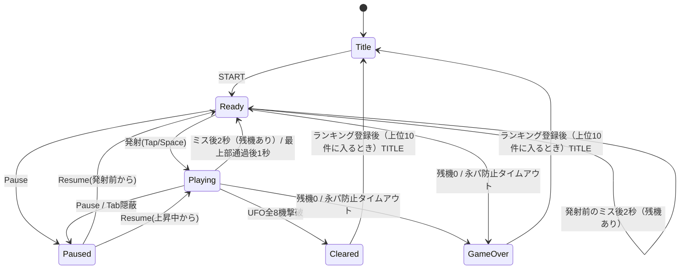

# 『ギャラクシーウォーズ』再現開発仕様書

* **版**：1.4（2026-10-26）
* **対象**：1979年アーケード名作『ギャラクシーウォーズ』（ユニバーサル／タイトー）の完全再現Webアプリ（HTML5 Canvas 2D / PWA / タッチ・PC両対応）を開発・再現するための全製品・実装仕様書。
* **位置づけ**：ソースコードおよび動作環境を再現するために必要なすべてのゲーム物理、スコア計算、基板挙動差、サウンド合成、PWA設計を網羅した本質的開発仕様書。

## 改訂履歴

| 版 | 日付 | 内容 |
| :--- | :--- | :--- |
| 1.0 | 2026-10-26 | 初版（doc/galaxy_wars_spec.md を元に作成） |
| 1.1 | 2026-10-26 | ステージを 1 面のみにする（doc/requests/2026-10-26-stage1-only.md）。§1、§1.1、§3.2、§3.3、§6.1、§6.2、§7、§8.1、§9、§12、§17 |
| 1.2 | 2026-10-26 | 未決事項を決め、タイトー版に固定する（doc/requests/2026-10-26-spec-1.2-open-items.md）。§1.1、§2.1、§3.1、§3.2、§3.4、§3.5、§6.3、§7、§11、§19 |
| 1.3 | 2026-10-26 | ゲームオーバーでもランキングに登録する（doc/requests/2026-10-26-gameover-ranking.md）。§7、§9 |
| 1.4 | 2026-10-26 | 詳細設計で決めた値を足す（doc/requests/2026-10-26-spec-1.4-design-values.md）。§2.1、§3.1〜§3.4、§5.2、§6.1〜§6.3、§7、§9、§11、§16〜§19、§21〜§23 |

---

## 仕様書 目次

### 第 1 部 製品仕様（Product Specification）
1. [概要](#1-概要)
2. [フィールドと座標系](#2-フィールドと座標系)
3. [ゲームオブジェクト](#3-ゲームオブジェクト)
4. [操作仕様](#4-操作仕様)
5. [ゲームの進行と物理](#5-ゲームの進行と物理)
6. [スコア＆エクステンド仕様](#6-スコア＆エクステンド仕様)
7. [状態遷移](#7-状態遷移)
8. [画面仕様＆メッセージ演出](#8-画面仕様＆メッセージ演出)
9. [ハイスコアランキング＆保存](#9-ハイスコアランキング＆保存)
10. [非機能要件](#10-非機能要件)
11. [パラメータ一覧](#11-パラメータ一覧)
12. [受け入れ基準](#12-受け入れ基準)

### 第 2 部 実装仕様（Implementation Specification）
13. [開発環境](#13-開発環境)
14. [技術構成](#14-技術構成)
15. [プロジェクトの設定](#15-プロジェクトの設定)
16. [ファイル構成とアーキテクチャ層](#16-ファイル構成とアーキテクチャ層)
17. [主なデータ型と関数](#17-主なデータ型と関数)
18. [画面の骨組みとルーティング](#18-画面の骨組みとルーティング)
19. [描画・カラーパレット・被弾演出](#19-描画・カラーパレット・被弾演出)
20. [入力エンジン](#20-入力エンジン)
21. [端末内保存実装](#21-端末内保存実装)
22. [Web Audio 音色合成仕様](#22-web-audio-音色合成仕様)
23. [PWA・オフライン・起動復旧](#23-pwa・オフライン・起動復旧)
24. [テスト・CI・公開](#24-テスト・ci・公開)
25. [再現の確認基準](#25-再現の確認基準)

---

# 第 1 部 製品仕様

## 1. 概要
1979年にユニバーサルより登場しタイトーからもライセンス販売された固定画面シューティングゲーム『ギャラクシーウォーズ』を、スマートフォンの縦画面およびPCブラウザ上で動作するPWAアプリとして完全再構築する。
自機から弾を撃つのではなく「プレイヤーが誘導ミサイル（自機）そのものを操作して敵UFOに体当たりする」独特の操作感と緊迫感を忠実に再現する。
本アプリ（ギャラクシーウォーズミニ）で遊べるのは **1面のみ** とし、1面クリアでゲームを終える。

### 1.1 範囲
* **製品範囲**：ゲーム物理・判定、操作系、スコア体系、タイトー版の挙動（固定）、擬似カラー表示、Web Audio音色合成、PWAオフライン対応、端末内ハイスコアランキング。
* **選定可能要素**：グラフィック表示方式（ピクセルパーフェクト描画 / 擬似カラーセロハンシェーダー切替）。
* **範囲外**：2面以降（面の進行による難易度変化・面別得点表・面別クリアメッセージ）。ユニバーサル版の挙動と、基板の版の切り替え。

### 1.2 前提条件
* **決定性**：乱数要素を排除し、固定タイムステップ（1/120秒）による物理計算を採用。同一入力列からは必ず同一のゲーム展開およびスコアが得られること。
* **通信仕様**：サーバー通信を行わず、ハイスコアおよび設定値はすべて端末内（localStorage）に完結して保存する。
* **想定端末**：スマホ縦画面（3:4レトロ比率維持）を基本とし、タッチ操作（操作空間）およびPCキーボード/マウス操作に対応。

---

## 2. フィールドと座標系
物理計算および描画の基準として、幅 480 × 高さ 640 の論理座標系を使用する。

```
x=0                                        x=480
┌──────────────────────────────────────────┐ y=0
│ SCORE : 00000        HIGH : 03000        │  HUD 帯 (y=0〜48)
├──────────────────────────────────────────┤ y=48 (天井)
│  UFO 上段 (右移動)  🛸  🛸  🛸  🛸       │ y=64〜88
│  UFO 下段 (左移動)  🛸  🛸  🛸  🛸       │ y=96〜120
│ ──────────────────────────────────────── │
│         🪨     🪨     🪨     🪨           │ 隕石 往復領域
│      🪨     🪨     🪨     🪨              │ (y=120〜560)
│                                          │
│                    🚀 (誘導ミサイル)     │
│ ──────────────────────────────────────── │
│                [ 🚀 ] (発射台)           │ y=580〜612 最下段待機・移動域
└──────────────────────────────────────────┘ y=640 (最下端)

┌──────────────────────────────────────────┐
│        ここをなぞって移動 / タップで発射 │ 操作空間 (タッチ端末用: 高さ96)
└──────────────────────────────────────────┘
```

### 2.1 領域構成
| 領域 | y範囲 | 説明 |
| :--- | :--- | :--- |
| **HUD帯** | 0 – 48 | スコア、ハイスコア・残機表示領域 |
| **UFO通過領域** | 48 – 120 | 上段4機（右移動）、下段4機（左移動）が往復する（画面の端を出たら反対の端から出る。§3.2） |
| **隕石往復領域** | 120 – 580 | 隕石が牛耕式パターン（左右往復＋降下）で移動する |
| **発射台待機領域** | 580 – 612 | 発射台（ランチャー）および発射前ミサイルの待機・横移動領域 |
| **操作空間** | フィールド外 (高さ96) | タッチ操作用入力エリア（指で画面が隠れるのを防止） |

---

## 3. ゲームオブジェクト

### 3.1 発射台（ランチャー）および誘導ミサイル（自機）
* **寸法**: 発射台 幅 48 × 高さ 16 px / ミサイル 幅 12 × 高さ 24 px
* **位置**: 物の位置は中心の座標で表す。発射台の中心は y = 608（上端 600〜下端 616。ミサイルの下の部分が発射台に差し込まれた形）。
* **発射前挙動**:
  * 画面最下部（y = 596）で発射台上に固定。レバー左右操作で横移動。
  * 発射台の中心 x は 24〜456 で、画面の端で止まる。横の速さは、キーで 240 px/秒、指・マウスの x へ近づくときは上限 480 px/秒。
  * 最下段を走る隕石の高度は発射前ミサイルの先端（y = 584）と重なるため、発射を躊躇すると隕石に接触してミスとなる。
* **発射後挙動（誘導ミサイル操作）**:
  * **通常上昇（噴射ボタン非押下）**:
    * ジェット音なし・バックファイア描画なし。
    * 横移動速度：低速（UFO残り6機時の横移動速度と同等：120 px/秒）。
    * 上昇速度：180 px/秒。
  * **加速噴射（噴射ボタン押下）**:
    * ジェット音再生・バックファイアアニメーション描画あり。
    * 横移動速度：高速（UFO残り2機時の横移動速度と同等：240 px/秒）。
    * 上昇速度：280 px/秒。
  * ミサイルの中心 x は 6〜474 で止まる。
* **画面最上部到達**:
  * 敵や障害物に接触せず画面最上部（y < 48）へ抜けた場合、ミスにはならず、1秒後に画面下部から発射台とともに再登場する（発射前の状態に戻る。残機は減らない）。
  * 「抜けた」は、ミサイルの下端が y = 48 より上に出たとき。再登場の発射台は x = 240（ミスのあとも同じ）。

### 3.2 敵UFO
* **配置**: 上段4機（右へ移動、中心 y = 76）、下段4機（左へ移動、中心 y = 108）の計8機。大きさは 32 × 24。両段とも x = 60・180・300・420 から始める。
* **画面端**: 段ごとに向きは変わらない。画面の端を出たら、反対の端から出る。
* **移動速度**: 残存機数に応じて段階的に加速する。

  | 残存機数 | 8 | 7 | 6 | 5 | 4 | 3 | 2 | 1 |
  | :--- | :--- | :--- | :--- | :--- | :--- | :--- | :--- | :--- |
  | 速度（px/秒） | 80 | 100 | 120 | 140 | 160 | 180 | 240 | 320 |

* **UFO光線（攻撃）**:
  * 「ニョロニョロ線（波動状光線）」を真下へ撃つ。
  * 0.75秒ごとに、ミサイル（発射前は発射台）との横の距離がいちばん近いUFOが1発撃つ（乱数は使わない）。
  * 画面内に同時に出せるのは、UFOの残存機数が5機以上なら3発、4機以下なら4発。上限に達しているときは撃たない。
  * 光線の落下速度は 180 px/秒（1面の値で固定）。光線の大きさは 4 × 16。
  * 距離がいちばん近いUFOが2機以上あるときは、下段を先に、それでも同じなら番号（上段の左から0〜3、下段4〜7）の小さい方が撃つ。
  * 光線はUFOの真下から出る。発射台がいない間（ミス・最上部通過のあとの待ち）は撃たない。

### 3.3 隕石群（障害物＆盾）
* **大きさ**: 24 × 24（当たりの四角は 20 × 20）。
* **移動パターン（牛耕式 / Boustrophedon）**:
  * 画面両端で反転し、1段下がって逆方向へ進行。最下段到達後は最上段からループ登場。
  * 段は12段（中心 y = 136 + 40 × 段。最下段は 576）。中心 x が 12 と 468 で向きを変えて1段下がる。最上段は右へ進み、段ごとに向きが入れ替わる。
  * 初めの並び：12段で1周する道のりを5等分した位置に1個ずつ置く。
* **左右速度差**:
  * 右方向移動速度（UFO 3機相当：180 px/秒）は左方向移動速度（UFO 6機相当：120 px/秒）より速い。
* **出現数**:
  * 5個配置（1面の値で固定）。
* **盾としての利用**:
  * 隕石はミサイルの障害物であると同時に、上空からのUFO光線を防ぐ防御壁（盾）として機能する。

### 3.4 隠し仕様・特殊判定（バグ技再現）
* **光線弾き（Reflect）**:
  * ミサイル先端中央〜やや斜めの判定範囲（横幅4px）で正面上方から敵光線を受けると、自機は無傷のまま光線を弾き返す。弾かれた光線は向きを変えて上へ飛び、画面の上で消える。UFOには当たらない。
  * 弾く条件：光線の中心 x がミサイルの中心から ±2 px 以内（先端の中央・横幅 4 px）で、直前のステップで光線の下端がミサイルの先端より上にあった（正面の上から来た）。ミサイルが横に動いていても（やや斜め）、発射前でも弾く。

### 3.5 永久パターン防止機能
* ミサイル登場後、UFOを1機も撃破しないまま 1分30秒 経過すると残機が強制的に1に減少。
* さらに 1分 経過（計2分30秒経過）で強制ゲームオーバーとなる。
* タイマーが0に戻るのは、UFOを撃破したときだけ。ミスしても戻らない。

---

## 4. 操作仕様

### 4.1 操作デバイス対応
| 操作アクション | タッチ入力 | マウス / キーボード |
| :--- | :--- | :--- |
| **発射台・ミサイル横移動** | 操作空間またはフィールドのなぞり | マウス移動 / `←` `→` / `A` `D` |
| **ミサイル発射** | 操作空間またはフィールドのタップ | クリック / `Space` |
| **加速噴射** | 画面長押し（ボタン押下継続） | マウスボタン長押し / `Space` 保持 |
| **一時停止** | UI「Pause」ボタン | `P` / `Esc` |

---

## 5. ゲームの進行と物理

### 5.1 物理演算ループ
* 固定タイムステップ **1/120秒（約8.333ms）** で計算。
* フレーム落ちが発生しても最大の累積ステップ更新数は100ms（12ステップ）に制限し、すり抜け事故を防止する。

### 5.2 衝突判定優先順位
1. **ミサイル vs 隕石**: 接触時即座にミス判定（爆発エフェクト発生）。
2. **ミサイル vs UFO部位**: 判定部位に応じて得点加算し、UFO撃破。
3. **ミサイル vs UFO光線**: 光線弾き判定領域以外での接触時ミス判定。発射前の発射台に光線が当たってもミス。

* 当たり判定は四角どうしの重なりで調べる。辺が接しただけは当たりにしない。
* ミスかクリアが決まったら、そのステップの残りの判定はしない。

---

## 6. スコア＆エクステンド仕様

### 6.1 部位別撃墜得点テーブル
| 側面・上部 | 下部中央 | 下部突起部分（2ヶ所） |
| :--- | :--- | :--- |
| 50点 | 100点 | 150点 |

（1面の値。2面以降は範囲外）

部位の四角（UFOの中心からの範囲）：

| 部位 | x | y |
| :--- | :--- | :--- |
| 側面・上部 | −16〜16 | −12〜4 |
| 下部中央 | −6〜6 | 0〜8 |
| 下部突起部分 | −14〜−8 と 8〜14 | 4〜12 |

* ミサイルが重なった部位のうち、得点の高い方を取る。

### 6.2 600点ボーナスUFO
特定順番で撃墜するUFOの「突起部分」に命中させると、特別ボーナス **600点** が獲得できる。
* 3機撃墜後、**4機目**のUFO突起（1面の値）
* 600点は、突起の150点の代わりに入る。

### 6.3 エクステンド（増機）
* ゲーム開始時の発射台（残機）は **3基**（画面に出ている1基を含む）。
* 累計 **3,000点** 到達時に発射台（残機）が1基増機される。増機は1回だけ。
* 残機UI表示にはミサイルではなく「発射台アイコン」を使用する。
* スコアは 99,999 で止める。

---

## 7. 状態遷移



* ミス時は爆発エフェクトと被弾フラッシュを出し、2秒後に次の発射台が登場して発射前（Ready）に戻る。撃破済みのUFOは復活しない。隕石は動き続ける。爆発の絵は0.4秒。
* 最後の1基でミスしたときも、2秒待ってからゲームオーバーにする。

---

## 8. 画面仕様＆メッセージ演出

### 8.1 クリアメッセージ演出
1面クリア（UFO全8機撃破）時、画面中央にクリアの表示を出し、ゲームを終えてランキング登録へ進む。
* クリアの表示の文言は画面設計（03）で決める。
* 原作の面別評価メッセージ（3面 `GOOD!!` 〜 33面 `GIVE UP!!`）は範囲外。

---

## 9. ハイスコアランキング＆保存

* 端末内保存（localStorage）を使用し、上位10件のランキング（スコア、プレイヤー名、日時）を管理。
* クリアかゲームオーバーでゲームが終わり、スコアが上位10件に入るとき、名前を入れて登録する。入らないときは登録しない。0点は登録しない。
* 同じスコアは、先に登録した方を上にする。
* 名前は英大文字・数字・空白の1〜8文字。空のときは `PLAYER`。
* JSON書き出し／読み込み（バックアップ・復元）機能を標準搭載。

---

## 10. 非機能要件

1. **フレームレート**: 主要モバイルブラウザおよびPCにて60fpsを維持。
2. **決定性検証**: 乱数非使用により、入力再現ログで完全に同じ展開が再現可能。
3. **完全オフライン動作**: PWAキャッシュ機能により一度読み込み後は完全スタンドアロン動作。

---

## 11. パラメータ一覧

| パラメータ名 | 定数値 | 単位 | 説明 |
| :--- | :--- | :--- | :--- |
| `FIELD_WIDTH` | 480 | px | フィールド論理幅 |
| `FIELD_HEIGHT` | 640 | px | フィールド論理高さ |
| `MISSILE_SPEED_NORMAL` | 180 | px/秒 | ミサイル通常上昇速度 |
| `MISSILE_SPEED_BOOST` | 280 | px/秒 | 加速噴射時上昇速度 |
| `MISSILE_LATERAL_LOW` | 120 | px/秒 | 通常時横移動速度（UFO 6機相当） |
| `MISSILE_LATERAL_HIGH` | 240 | px/秒 | 加速時横移動速度（UFO 2機相当） |
| `UFO_SPEEDS` | 80, 100, 120, 140, 160, 180, 240, 320 | px/秒 | UFO横移動速度（残存8機〜1機） |
| `BEAM_SPEED` | 180 | px/秒 | UFO光線の落下速度 |
| `BEAM_INTERVAL` | 0.75 | 秒 | UFO光線の発射間隔 |
| `BEAM_MAX` | 3 / 4 | 発 | 光線の同時数（UFO 5機以上 / 4機以下） |
| `INITIAL_LIVES` | 3 | 基 | 開始時の発射台数（画面上の1基を含む） |
| `MISS_RESPAWN` | 2 | 秒 | ミスから次の発射台登場まで |
| `EXIT_RESPAWN` | 1 | 秒 | 最上部通過から発射台再登場まで |
| `EXTEND_SCORE` | 3000 | 点 | 増機スコア（1回のみ） |
| `PERMANENT_TIMEOUT_1` | 90 | 秒 | 永パ防止第一段階（残機1化） |
| `PERMANENT_TIMEOUT_2` | 150 | 秒 | 永パ防止第二段階（強制終了） |
| `LAUNCHER_Y` | 608 | px | 発射台の中心 y |
| `LAUNCHER_KEY_SPEED` | 240 | px/秒 | キーでの発射台の横移動速度 |
| `LAUNCHER_POINTER_SPEED` | 480 | px/秒 | 指・マウスの x へ近づく発射台の速度の上限 |
| `UFO_SIZE` | 32 × 24 | px | UFOの大きさ |
| `BEAM_SIZE` | 4 × 16 | px | 光線の大きさ |
| `REFLECT_WIDTH` | 4 | px | 光線弾きの判定範囲（先端の中央 ±2） |
| `METEOR_SIZE` | 24（当たり 20） | px | 隕石の大きさ |
| `METEOR_LANES` | 12 | 段 | 隕石の段の数（y = 136 + 40 × 段） |
| `EXPLOSION_TIME` | 0.4 | 秒 | 爆発の絵を出す長さ |
| `SCORE_MAX` | 99999 | 点 | スコアの上限 |

---

## 12. 受け入れ基準

* [ ] 発射台待機中のミサイル先端が隕石と接触してミスになること。
* [ ] ボタン押下による加速噴射時に音とバックファイアが発生し、横移動が高速化すること。
* [ ] ミサイル先端での光線受弾時に弾き（Reflect）が正しく発動すること。
* [ ] UFO全8機の撃破でクリアの表示が出てゲームが終わり、ランキング登録に進むこと。
* [ ] 3,000点到達時に増機音が鳴り、発射台アイコンが増加すること。

---

# 第 2 部 実装仕様

## 13. 開発環境
* **OS**: クロスプラットフォーム (Node.js 24系)
* **パッケージ管理**: npm
* **ビルドツール**: Vite ^8.3.4
* **言語**: TypeScript ~6.0.3 (Strict Mode)

---

## 14. 技術構成
* **描画**: HTML5 Canvas 2D API (2D Context)
* **音源**: Web Audio API (オシレーター直打ち合成音)
* **PWA**: vite-plugin-pwa (Workbox / Service Worker)
* **テスト**: Vitest (ロジック単体テスト), Playwright (E2Eテスト)

---

## 15. プロジェクトの設定

### `package.json` 構成案
```json
{
  "name": "galaxy-wars-reproduction",
  "version": "1.0.0",
  "private": true,
  "type": "module",
  "scripts": {
    "dev": "vite",
    "build": "tsc --noEmit && vite build",
    "preview": "vite preview",
    "test": "vitest run",
    "test:e2e": "playwright test"
  }
}
```

---

## 16. ファイル構成とアーキテクチャ層

```
public/
└── boot.js                # 起動復旧（§23）
src/
├── core/                  # ロジック層（純粋関数・決定性・DOM依存なし）
│   ├── config.ts          # システムパラメータ定数
│   ├── types.ts           # 状態・入力の型
│   ├── game.ts            # ゲーム状態管理・メインステップ更新
│   ├── physics.ts         # 衝突判定・光線弾き・牛耕式移動アルゴリズム
│   ├── scoring.ts         # 部位別スコア・600点ボーナス計算
│   ├── timestep.ts        # 経過時間 → ステップ数（最大12）
│   └── sound-plan.ts     # 各フレームの再生イベントキュー計画
├── render/                # 画面描画層
│   ├── canvas.ts          # Canvas 2D 描画エンジン
│   ├── color-palette.ts   # 擬似カラーセロハン・被弾フラッシュ制御
│   └── sprites.ts         # UFO・ミサイル・隕石・フォント描画
├── audio/                 # 音響層
│   └── synthesizer.ts     # Web Audio API オシレーター合成器
├── storage/               # 基盤層
│   ├── ranking-store.ts   # localStorage & JSON バックアップ機能
│   └── settings-store.ts  # 設定（表示方式）
├── app/                   # 組み立て層（ルーティング・画面・入力・ループ・PWA・デバッグ）
└── main.ts                # アプリケーションエントリーポイント
```

* `core` は DOM・時刻・乱数に触れない。決まりは ESLint で守る。

---

## 17. 主なデータ型と関数

### `src/core/types.ts`
```typescript
export type GameStatus = 'ready' | 'playing' | 'respawn' | 'paused' | 'cleared' | 'gameOver';
// respawn: ミス・最上部通過のあとの待ち

export type UfoPart = 'body' | 'bottom' | 'prong'; // 側面・上部 / 下部中央 / 突起

export interface Missile {
  x: number;
  y: number;
  isBoosting: boolean;
  isLaunched: boolean;
}

export interface UFO {
  id: number;
  x: number;
  y: number;
  row: 0 | 1; // 0: 上段(右移動), 1: 下段(左移動)
  isAlive: boolean;
}

export interface Meteor {
  pos: number;  // 牛耕式の道のりの位置
  x: number;
  y: number;
  lane: number;
  direction: 1 | -1; // 1: 右, -1: 左
}

export interface Beam { x: number; y: number; vy: number; reflected: boolean; }

export interface GameState {
  status: GameStatus;
  pausedFrom: 'ready' | 'playing' | 'respawn' | null;
  stepCount: number;
  score: number;
  highScore: number;
  lives: number; // 発射台残数（画面上の1基を含む）
  extended: boolean;
  launcherX: number;
  missile: Missile;
  ufos: UFO[];
  killCount: number;
  meteors: Meteor[];
  beams: Beam[];
  beamTimer: number;   // ステップ
  idleSteps: number;   // 永久パターン防止タイマー（ステップ）
  waitSteps: number;
  waitReason: 'miss' | 'exit' | null;
  flashSteps: number;
  explosion: { x: number; y: number; steps: number } | null;
  lastKill: { part: UfoPart; points: number } | null;
}

export interface StepInput {
  dir: -1 | 0 | 1;          // キー
  targetX: number | null;   // 指・マウスの x
  launch: boolean;          // このステップで発射
  boost: boolean;           // 加速噴射中
}
```

### 主な関数
* `newGame(highScore)`、`step(state, input)`（新しい状態を返す）、`togglePause(state)`（`src/core/game.ts`）
* `planSteps(acc, elapsedMs)`（`src/core/timestep.ts`）、`planSounds(prev, next)`（`src/core/sound-plan.ts`）

---

## 18. 画面の骨組みとルーティング

HTML5シングルページアプリ構造とし、`#/title`, `#/play`, `#/ranking` のハッシュルーティングで画面遷移を制御する。

* 設定と名前の入力は、ハッシュを増やさず画面に重ねて出す。
* テスト用に、body に状態の data 属性（`data-screen`・`data-status`・`data-score` など）を付ける。`?debug=1` のときだけ、`window.__mgw`（状態の読み書き・ループの停止とステップ実行）とデバッグ表示（fps・ステップ数）を置く。

---

## 19. 描画・カラーパレット・被弾演出

### 被弾時フラッシュ制御
* 被弾時に画面全体を `#FF0000` (赤) で 100ms フラッシュする（タイトー版。ユニバーサル版の青フラッシュは範囲外）。

### 擬似カラーセロハン再現シェーダー (Canvas Composite)
* 画面上部 (UFO域): 紫/赤系 オーバーレイ（y 0〜120、`#FF50D0`）
* 画面中央 (隕石域): 透明/白系（y 120〜580、重ねない）
* 画面下部 (発射台域): 緑系 オーバーレイ（y 580〜640、`#50FF70`）
* `globalCompositeOperation = 'multiply'` で重ね、白い絵だけに色を乗せる。ピクセルパーフェクト描画では重ねない。

---

## 20. 入力エンジン

Pointer Events API を採用し、タッチ端末ではゲームエリア下の「操作空間」でのスライド操作を論理 `x` 座標へと変換し、ミサイル発射台を追従させる。

---

## 21. 端末内保存実装

`localStorage` キー `galaxy-wars-scores` に上位10件の記録をJSON化して保持。バックアップJSONフォーマット構造を標準提供。

```json
{ "app": "mini-galaxywars", "version": 1,
  "entries": [ { "score": 3550, "name": "PLAYER", "date": "2026-10-26T16:52:10+09:00" } ] }
```

* 書き出しのファイルも同じ形（`mini-galaxywars-ranking-YYYYMMDD.json`）。
* 読み込みでは、`app`・`version`・件数（10件まで）・各項目（score 0〜99999の整数、name `^[A-Z0-9 ]{1,8}$`、date）を調べ、合わなければ今の記録を変えない。
* 設定は `mini-galaxywars-settings` に `{ "app": "mini-galaxywars", "version": 1, "displayMode": "cellophane" | "pixel" }`。

---

## 22. Web Audio 音色合成仕様

オリジナルアーケード基板の4系統音源をオシレーターでリアルタイム合成。

| 効果音 | オシレーター波形 | 周波数・変化仕様 |
| :--- | :--- | :--- |
| **ミサイル上昇音** | 矩形波 (Square) | 440 Hz → 880 Hz ピッチ上昇スイープ |
| **UFO破壊音** | ノイズ / 鋸波 | ホワイトノイズ＋低音減衰（120 Hz → 30 Hz） |
| **エクステンド音** | 三角波 (Triangle) | 523 Hz → 659 Hz → 784 Hz アルペジオ |
| **ミス爆発音** | 低音ノイズ | 重低音ノイズ＋爆発エンベロープ |

* ミサイル上昇音は加速噴射の間だけ、0.3秒のスイープをくり返す。
* UFO破壊音は0.4秒、エクステンド音は各音0.12秒（最後0.3秒）、ミス爆発音は0.8秒（低域通過 400 Hz → 80 Hz）。
* ノイズは決まった式の擬似乱数で作り、`Math.random` は使わない。

---

## 23. PWA・オフライン・起動復旧

`vite-plugin-pwa` を使用し、全静的アセットを Service Worker でキャッシュ。8秒以上ロードが完了しない場合の起動復旧ダイアログ（`boot.js`）を組み込む。

* 新しい版は「更新」ボタンで切り替える（`registerType: 'prompt'`）。プレイ中は切り替えない。
* `boot.js` はアプリより先に読み込む普通のスクリプト。アプリが起動を知らせなければ、8秒後に「再読み込み」と「キャッシュを消して再読み込み」を出す。後者は Service Worker の登録と `mini-galaxywars` のキャッシュを消す。ランキング（localStorage）は消さない。

---

## 24. テスト・CI・公開

* **Vitest**: 衝突判定およびスコア計算の決定性テスト。
* **GitHub Actions**: 自動ビルド、Lint、E2Eテスト、GitHub Pages自動デプロイ。

---

## 25. 再現の確認基準

* [ ] 第1部 §12 のすべての受け入れ基準を満たすこと。
* [ ] 外部CDNや外部ネットワークアクセスなしで完全オフライン動作すること。
* [ ] 固定タイムステップ (1/120s) の物理整合性が実機スマートフォンで証明されること。
